# Kit2Code Grader — Architecture & Migration Plan

**Scope:** split `grader_prototype` into an API-only backend (`Kit2Code/backend`) and a React + Vite
frontend (`Kit2Code/website`), following *Grader API Contract & React + Vite Frontend Handoff*
(rev. 2026-10-26); then add monthly rated contests on CMS 1.5.1.
**Revision 9 — 2026-10-29.** History: rev. 1 architecture · rev. 2 hostile review (§16–§20) ·
rev. 3 PDF problem page (§21) · rev. 4–5 contests and ratings (§22–§37) · rev. 6 six-reviewer
audit (§38–§42) · rev. 7 owner's answers applied, every review finding folded into the body ·
rev. 8 laptop hosting and optimizations (§43–§47) · rev. 9 phased move to the laptop. Written from the prototype's `main`, the website repo's
first commit and the CMS v1.5.1 source.

All diagrams are Mermaid, so they render directly on GitHub.

---

## 0. TL;DR

- **Keep** what the prototype does well: one Django image with two roles, the edge (Caddy) as the
  only entry point, Postgres as the queue, the isolate worker, secrets, networks.
- **Change** the public role from HTML pages to a JSON API under `/api/*` (DRF), and let the edge
  serve the React build at `/`. The admin site doesn't change.
- **Problem page:** statements are PDFs shown in the browser's own viewer inside an iframe, with a
  card + "Open PDF" on touch devices (§21).
- **Contests (v2):** monthly 90-minute CMS contests, one-click sign-in bound to the browser,
  a bridge service, live public scoreboard, Codeforces-style ratings with review and similarity
  check, auto-publish to practice; CMS moves into the stack (§22–§37).
- **Rev. 6 audit (§38–§42):** six reviewers rated rev. 5 at 5–7/10 and found real bugs, including
  two of mine (the edge didn't block `/admin`; a global retry change). All fixes are applied in
  place; §40 lists every contract change; §42 is the re-estimated roadmap with a v1/v1.1/v2 cut
  line.
- **Rev. 7:** ties use the average place; late joiners are rated; CMS goes into the stack from the
  first contest. Every finding now lives in its section.
- **Rev. 8–9 hosting:** start on the **ZimaOS NAS** (8 GB is fine for the practice site); move to the
  ASUS TUF A15 laptop (Ryzen 7, 16 GB, Ubuntu Server) **later, when you're ready — at the latest
  before contests need the full CMS stack**. No hardware purchase in either phase. If contests start
  before the move, the NAS runs them in a slimmed "8 GB contest mode". Free cloud tiers aren't a main
  host; student credit is the emergency plan. Ten optimizations (§46). Open questions: §36.

---

## 1. Repositories

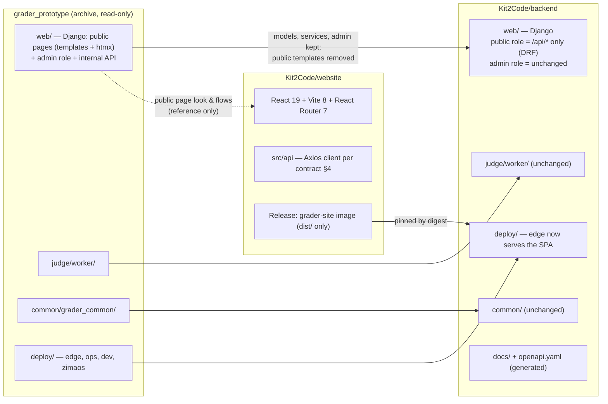

**How to create the backend repo (keeps git history, so `blame` and DECISIONS.md still make sense):**

```bash
git clone https://github.com/Kit2Code/grader_prototype.git backend
cd backend
git remote set-url origin https://github.com/Kit2Code/backend.git
git push -u origin main
# then archive grader_prototype on GitHub (Settings → Archive)
```

| Repo | Owner | Contains | Ships |
|---|---|---|---|
| `backend` | MiyaZaki | Django (both roles), worker, common, deploy, docs | 4 images: `grader-web`, `grader-worker`, `grader-edge`, `grader-ops` |
| `website` | frontend dev | React SPA | 1 image: `grader-site` (only the built `dist/`) |

---

## 2. Production: the whole system

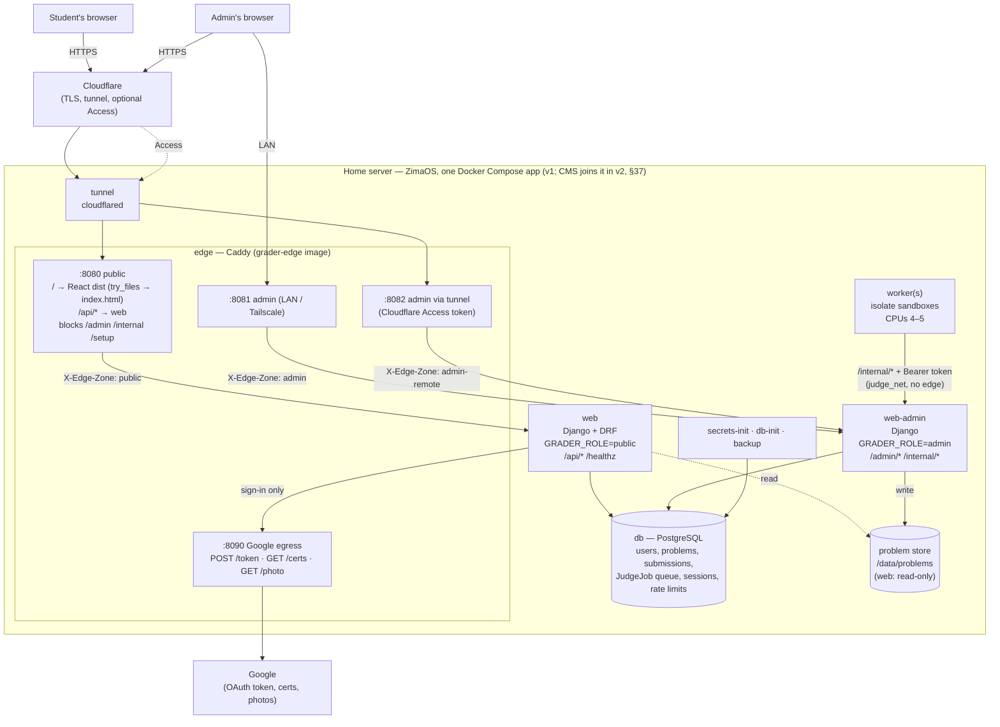

What is **new** compared to the prototype: only the `:8080` box (it now serves static files and
routes `/api/*`) and the inside of `web` (DRF instead of templates). Everything else stays.

### 2.1 Networks (unchanged)

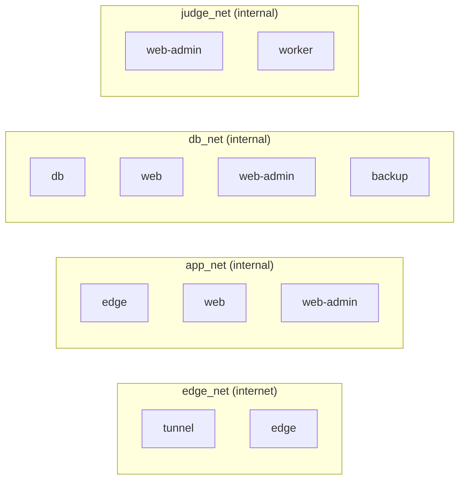

The worker still cannot reach the database or the internet; `web` can only reach Google through
edge `:8090`. Moving the frontend out does not need any network change: the SPA is static files
inside the edge.

---

## 3. The edge: routing the public port

### 3.1 Request routing on `:8080`

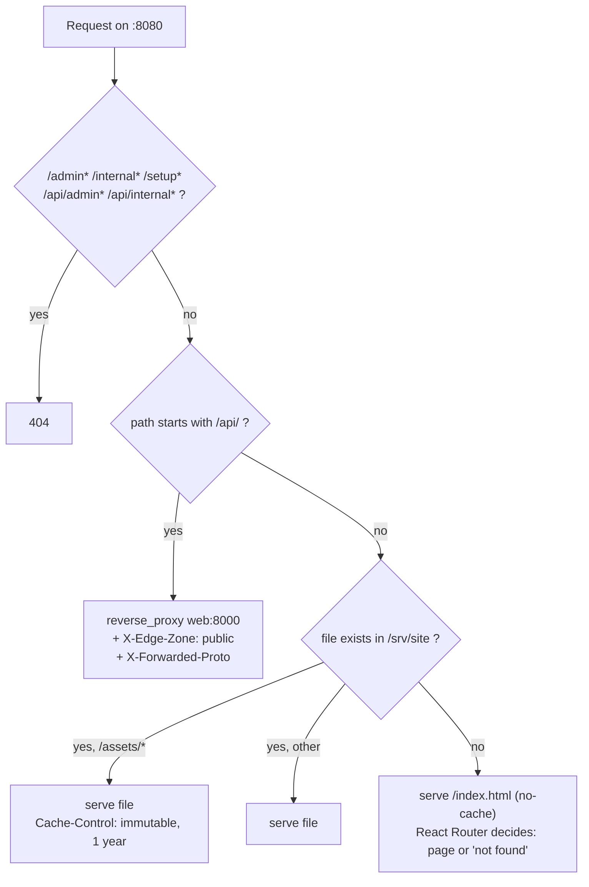

### 3.2 Caddyfile change (sketch)

```caddy
:8080 {
	import security_headers
	request_body {
		max_size 1MB
	}
	# MUST be a `handle`, and first. Rev. 1–5 had `respond @blocked 404` beside the handles below;
	# Caddy orders `handle` before `respond`, so the catch-all `handle` won and /admin, /setup,
	# /internal got index.html while /api/admin went to Django. Reproduced on Caddy 2.11 (review O-1).
	@blocked path /admin /admin/* /api/admin /api/admin/* /internal /internal/* /api/internal /api/internal/* /setup /setup/*
	handle @blocked {
		respond 404
	}

	handle /api/* {
		reverse_proxy {$GRADER_WEB_UPSTREAM:web:8000} {
			header_up X-Edge-Zone public
			header_up X-Forwarded-Proto {$GRADER_PUBLIC_PROTO:https}
			# Read the whole body at the edge before handing it to gunicorn, so a few slow uploads
			# can't hold the public role's 8 threads. Must be LARGER than max_size: with 1MB = 1MB a
			# 2 MB chunked upload streamed through to the backend; with 2MB it gets a JSON 413
			# (tested on Caddy 2.11.2, rev. 6). It does NOT add a Content-Length to a chunked body
			# (tested), so Django de-chunks it itself (§5.4).
			request_buffers 2MB
		}
	}

	# Compression for the SPA's files (rev. 8, §46 #1). API JSON is small, so it isn't compressed;
	# keeping `encode` out of /api/* also keeps the API's responses byte-for-byte what Django sent.
	handle /assets/* {
		encode zstd gzip
		root * /srv/site
		# Only real files are immutable; a 404 for a missing chunk must not be cached for a year.
		@asset_exists file
		header @asset_exists Cache-Control "public, max-age=31536000, immutable"
		file_server
	}

	handle {
		encode zstd gzip
		root * /srv/site
		try_files {path} /index.html
		header Cache-Control "no-cache"
		file_server
	}

	# Errors the edge makes itself (413 over 1 MB, 502/504 while web restarts) must still be the
	# contract's JSON on /api/*, or the frontend's error helper gets an empty or HTML body.
	handle_errors {
		@api_too_big expression `{http.request.uri.path}.startsWith("/api/") && {err.status_code} == 413`
		handle @api_too_big {
			header Content-Type application/json
			respond `{"error":{"code":"payload_too_large","message":"Request too large."}}` 413
		}
		@api_other path /api/*
		handle @api_other {
			header Content-Type application/json
			header Cache-Control no-store
			respond `{"error":{"code":"server_error","message":"Service unavailable. Try again."}}` {err.status_code}
		}
	}
}
```

HSTS: in the prototype Django sent `Strict-Transport-Security` on every page. HTML now comes from
Caddy, so turn on HSTS in Cloudflare (SSL/TLS → Edge Certificates) for the public hostname; Django
keeps sending it on `/api/*`. Do not hard-code it in the shared Caddyfile, because the dev stack
runs the same file over plain HTTP.

Notes:
- The edge already returns `404` for unknown paths it blocks; for everything else the SPA shows its
  own not-found page (HTTP 200 from `index.html`). API `404`s still come from Django as JSON.
- `/healthz` stays on Django at the container's root (Docker healthcheck only), not under `/api`.
- **Tested (rev. 6, re-tested rev. 8 with compression):** this block was run on Caddy 2.11.2 against
  a stub backend. All blocked paths below → 404 without reaching the stub; SPA fallback and asset
  caching as described; assets come back gzip/zstd; 2 MB bodies (with `Content-Length` and chunked)
  → JSON 413 (12 of 12 runs); backend down → JSON 502.
- **What a chunked oversize upload really does:** the edge does **not** hold it back. It starts
  streaming the body to Django, stops at 1 MB, cuts the connection and answers the client 413.
  So Django can receive up to 1 MB of a body that is then cut off — the WSGI de-chunker (§5.4) must
  enforce its own cap and treat a cut-off body as an error. **The edge tests need a stub that reads
  the body** (like Django does): a stub that answers without reading it races the edge and produces
  random 200s and 502s — that cost a round of false alarms here.
- **Write these edge tests before changing the Caddyfile** (`deploy/tests/test_edge.py`; the rev. 1–5
  sketch passed `caddy validate` and still failed them): `/admin`, `/setup`, `/internal/x`,
  `/api/admin`, `/API/admin`, `/%61pi/internal`, `//admin` → 404 and never reach the stub web;
  `/problems/aplusb` → `index.html`; `/api/x` → stub web with `X-Edge-Zone: public`;
  `/assets/real.js` immutable, `/assets/missing.js` 404 **without** the immutable header; 2 MB body
  with `Content-Length` and 2 MB chunked → JSON 413 (not 502); web stopped → JSON 502.

### 3.3 Getting `dist/` into the edge

```dockerfile
# deploy/edge/Dockerfile (backend repo)
ARG SITE_IMAGE=ghcr.io/kit2code/grader-site@sha256:<digest>
FROM ${SITE_IMAGE} AS site
FROM caddy:<pinned> 
COPY --from=site /dist /srv/site
COPY Caddyfile /etc/caddy/Caddyfile
# ...existing edge-start.sh etc.
```

```dockerfile
# Dockerfile (website repo) — the image is just files
FROM node:<pinned by digest> AS build
WORKDIR /app
COPY package*.json ./
# No install scripts: a compromised dependency can't run code at install time. (Vite 8/rolldown
# ship prebuilt binaries as optional dependencies, so the build does not need them; verify once.)
RUN npm ci --ignore-scripts
COPY . .
RUN npm run build
FROM scratch
COPY --from=build /app/dist /dist
```

Why this way: one entry point (no extra container), the release still pins every image by digest,
and a frontend release is "bump one digest in the backend repo" — reviewable and reversible.

---

## 4. Development environment

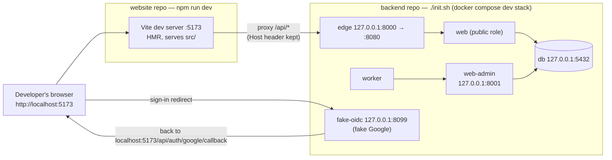

**Frontend — `vite.config.js`** (keep the existing React Compiler plugins):

```js
import react, { reactCompilerPreset } from '@vitejs/plugin-react'
import babel from '@rolldown/plugin-babel'
import { defineConfig } from 'vite'

export default defineConfig({
  plugins: [react(), babel({ presets: [reactCompilerPreset()] })],
  server: {
    port: 5173,
    strictPort: true,
    proxy: {
      // Do NOT set changeOrigin: true — Django must see Host: localhost:5173,
      // which is PUBLIC_BASE_URL in dev (ALLOWED_HOSTS + CSRF origin check).
      '/api': { target: 'http://127.0.0.1:8000' },
    },
  },
})
```

**Backend dev env (`.env`):**

```
PUBLIC_BASE_URL=http://localhost:5173
FAKE_OIDC_REDIRECT_URIS=http://localhost:5173/api/auth/google/callback
```

`settings.py` already derives `ALLOWED_HOSTS` and `CSRF_TRUSTED_ORIGINS` from `PUBLIC_BASE_URL`,
so no other setting is needed.

**Frontend without a backend:** add [MSW](https://mswjs.io/) handlers built from the contract's
example JSON so pages can be built before endpoints exist. Delete them per endpoint as the real
one lands.

---

## 5. Backend architecture (Django)

### 5.1 Layers

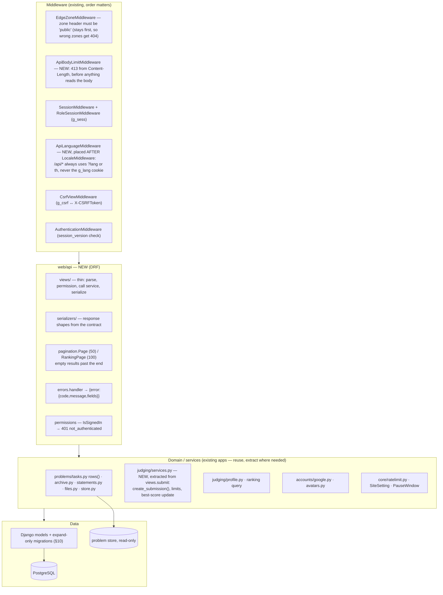

**Rule:** a DRF view never contains query or business logic. Where today's template view mixes
logic and rendering (`judging/views.submit`, `problems/views.problem_list`), first move the logic
into a function both can call, then write the API view. This keeps the fixed-query-count behaviour
(`tasks.rows()`, archive counts) and avoids two copies of the rate-limit rules during the
migration.

### 5.2 New package layout

```
web/
├── api/                         # NEW — mounted only in config/urls_public.py
│   ├── urls.py                  # path("api/", include("api.urls"))
│   ├── errors.py                # exception handler + code mapping (§12 of contract)
│   ├── pagination.py
│   ├── language.py              # ApiLanguageMiddleware
│   ├── permissions.py
│   ├── serializers/             # site, problems, groups, submissions, users, auth
│   ├── views/                   # same split
│   └── tests/                   # one test module per endpoint group + schema test
├── accounts/  problems/  judging/  core/    # KEEP models, services, admin, migrations
│   └── templates/…              # public templates deleted at cut-over (M4); admin ones kept
├── config/
│   ├── settings.py              # + rest_framework, drf_spectacular
│   ├── urls_public.py           # only: api/, healthz
│   └── urls_admin.py            # unchanged
```

**OpenAPI schema (fixed in rev. 2).** Never mount schema views on the public role. Generate the
file in CI (`manage.py spectacular --urlconf api.urls --file docs/openapi.yaml`) — the
`--urlconf` matters, or drf-spectacular documents whichever URLconf the process loaded. For Swagger
UI in dev, use `drf-spectacular-sidecar` (self-hosted assets): the default Swagger UI loads from a
CDN, which the edge's CSP blocks.

### 5.3 Endpoint → existing code map

| API | Method | Auth | Reuses |
|---|---|---|---|
| `/api/auth/me` | GET | – | `request.user`; `ensure_csrf_cookie` |
| `/api/auth/google/start`, `/callback` | GET (browser) | – | `accounts/google.py` (redirect targets change) |
| `/api/auth/register` | POST | pending sign-in | `accounts/views.welcome` + `forms.py` |
| `/api/auth/logout`, `/logout-everywhere` | POST | ✓ | `accounts/views.py` (`session_version`) |
| `/api/me` | PATCH | ✓ | `profile_settings`, `avatars.py` |
| `/api/site` | GET | – | `core/views.home`, `SiteSetting`, `PauseWindow` |
| `/api/problems` | GET | – | `problems/tasks.py` |
| `/api/problems/{slug}` | GET | – | `problem_detail`, `statements.py` |
| `/api/problems/{slug}/files/{name}` | GET | – | `problem_file`, `files.py`, `store.py` |
| `/api/problems/{slug}/submissions` | POST | ✓ | `judging/views.submit` → `services.create_submission` |
| `/api/groups`, `/api/groups/{slug}[/{sub}]` | GET | – | `problems/archive.py` |
| `/api/submissions`, `/mine` | GET | –/✓ | `all_submissions`, `my_submissions`, `SubmissionFilterForm` |
| `/api/submissions/{id}` | GET | – | `submission_detail`, `submission_results` |
| `/api/submissions/{id}/source` | GET | author | `submission_source` |
| `/api/ranking` | GET | – | `judging/views.ranking` |
| `/api/users/{username}` | GET | – | `judging/profile.py` |
| `/api/users/{username}/photo` | GET | – | `accounts/views.photo` |

**Reuse is not free (review B-8).** Some prototype code is tied to templates and needs a small
extraction first:

- `problems/views._task_table` and `archive_group`: paging uses `Paginator.get_page`, which clamps to
  the last page; the 404 and `problems: null` rules live in the view. Move them into
  `problems/archive.py` services that the API calls with explicit page numbers.
- `problems/archive.Folder` has a `url`, not the `id` and `slug` the contract needs; add both.
- `judging/views._limit_reached` returns an HTML page. Make it return `(code, retry_after)`;
  `retry_after` for `hourly_limit` comes from the rate-limit window (`core/ratelimit.py`), for
  `cooldown` from the last submission time, and `too_many_waiting` sends no `Retry-After`.
- `problems/tasks.Counts` defaults to 0; signed out, the contract wants `null` for everything but
  `all`.

**Submission serializer rules (review B-5).** The contract's per-state field table must hold even
when the database disagrees:

- mask fields by `status`: while `queued`/`judging`, send `verdict: ""`, `score: null`,
  `judged_at: null`, `subtasks: []`, `compile_log: null`, and only tests from the current run
  (a rejudge leaves the old `TestResult` rows in place until the new ones arrive);
- `max_time_ms` / `max_memory_mb` are `null` when no test ran (`complete()` stores 0 for CE today);
- round per-test `time_ms` to 10 ms and `memory_mb` to 0.1 MB **in the serializer** (today only a
  template filter does it, so the raw values would leak through JSON);
- the admin "rejudge" action also clears `judged_at`, `max_*`, `subtask_scores` and `compile_log`.

### 5.4 Settings additions

```python
INSTALLED_APPS += ["rest_framework", "drf_spectacular"]

REST_FRAMEWORK = {
    "DEFAULT_AUTHENTICATION_CLASSES": ["api.auth.StrictSessionAuthentication"],  # see below
    "DEFAULT_PERMISSION_CLASSES": ["rest_framework.permissions.AllowAny"],
    "DEFAULT_RENDERER_CLASSES": ["rest_framework.renderers.JSONRenderer"],  # no browsable API
    "DEFAULT_PARSER_CLASSES": [
        "rest_framework.parsers.JSONParser",
        "rest_framework.parsers.MultiPartParser",   # only the submit view needs it; others JSON only
    ],
    "EXCEPTION_HANDLER": "api.errors.handler",
    "DEFAULT_PAGINATION_CLASS": "api.pagination.Page",
    "DEFAULT_SCHEMA_CLASS": "drf_spectacular.openapi.AutoSchema",
    # Rev. 1 had "UNAUTHENTICATED_USER": None here. Removed: reused service code calls
    # request.user.is_authenticated, which crashes on None.
}
CSRF_COOKIE_HTTPONLY = False      # Axios must read g_csrf (Django's default; keep it explicit)
SESSION_COOKIE_SAMESITE = "Lax"   # NOT Strict: the OAuth callback is a cross-site top-level GET
```

**Two DRF defaults that break the contract (found in review).** Stock `SessionAuthentication`:

1. **checks CSRF only when the user is signed in.** DRF wraps every `APIView` in `csrf_exempt` and
   leaves CSRF to `SessionAuthentication`, which skips it for anonymous requests. So
   `POST /api/auth/register` (the user is not signed in yet) would accept requests with no CSRF
   token. `SameSite=Lax` blocks plain cross-site attacks, but not one from a *same-site*
   sibling (CMS or any other `*.<domain>` service with an XSS bug), and the contract promises
   `csrf_failed` on every unsafe method;
2. **answers "not signed in" with 403, not 401**, because it sends no `WWW-Authenticate` header.
   The contract and the frontend's auth handling depend on `401 not_authenticated`.

```python
# web/api/auth.py
from rest_framework.authentication import SessionAuthentication
from rest_framework.exceptions import PermissionDenied
from rest_framework.permissions import SAFE_METHODS

class CsrfFailed(PermissionDenied):
    default_code = "csrf_failed"

class StrictSessionAuthentication(SessionAuthentication):
    """Session auth that checks CSRF on every unsafe request and answers 401 when signed out."""

    def authenticate(self, request):
        if request.method not in SAFE_METHODS:
            try:
                self.enforce_csrf(request)          # signed in or not
            except PermissionDenied as exc:
                # A plain CsrfFailed(exc.detail) would keep the code 'permission_denied' (review S-9).
                raise CsrfFailed(str(exc.detail), code="csrf_failed") from exc
        user = getattr(request._request, "user", None)
        if user is None or not user.is_active:
            return None
        return (user, None)

    def authenticate_header(self, request):
        return "Session"                           # makes DRF send 401 for NotAuthenticated
```

Tests (M0, must fail before this class exists): `POST /api/auth/register` without a token →
`403 csrf_failed` (assert the **code**, not only the status); `GET /api/submissions/mine` signed
out → `401 not_authenticated`; and a test that walks every URL pattern under `api/` and fails if
any view handling an unsafe method has `authentication_classes` other than
`StrictSessionAuthentication` (an empty tuple would silently drop CSRF).

**Body size before parsing (rev. 6).** The prototype checks `CONTENT_LENGTH` inside the submit
view; under DRF that is too late (the CSRF check parses `request.POST` during authentication). Two
pieces:

1. **`config/wsgi.py` de-chunker.** Django reads a request body only up to `CONTENT_LENGTH`; a
   chunked body (no length) arrives **empty**. The edge's `request_buffers` does not add a length
   (review O-2), and whether cloudflared forwards chunked bodies is unverified. A small WSGI wrapper
   reads a chunked body (the edge already capped it at 1 MB), sets `CONTENT_LENGTH`, and replaces
   `wsgi.input` with the buffered bytes. It stops reading at 1 MB itself and answers 413, and a body
   that ends early (the edge cut it off) is answered 400, never passed on. No 411s at all: browsers
   often send no length on a bodiless `DELETE`, which is harmless.
2. **`ApiBodyLimitMiddleware`**, right **after** `EdgeZoneMiddleware` (so wrong-zone requests still
   get 404), public role only: `/api/*` unsafe requests over the limit → `413 payload_too_large`
   (256 KB for the submit path, 16 KB for other API bodies).

Smoke test through the **real tunnel**, not only the dev stack: a JSON submit, a multipart submit and
a 300 KB submit (→ 413).

**Language (review B-2).** `LocaleMiddleware` stays until M4b (old pages need it) and activates the
`g_lang` cookie. `ApiLanguageMiddleware` goes **after** it and, on `/api/*`, always activates
`?lang=` if it is `th`/`en`, otherwise `th` — so an old `g_lang=en` cookie can never leak into API
answers. An invalid `lang` value falls back to `th` (it's a hint, not data).

**Timestamps (review B-1).** `TIME_ZONE = "Asia/Bangkok"`, and DRF's `DateTimeField` converts to
the current time zone, so out of the box every timestamp would be `…+07:00`, not the contract's
`…Z`. Use one base serializer whose `DateTimeField`s have `default_timezone=datetime.UTC`, and a
schema test asserting the `Z` suffix on every timestamp field.

**Pagination (review B-10).** Stock DRF turns an out-of-range page into 404 and accepts
`?page=last`. The custom `Page` accepts only `^[1-9]\d*$` (else `400 validation_error`), returns
`results: []` with the real `count` past the end, and is called by hand for the archive's nested
`problems` list. Tests: `0`, `-1`, `1.5`, `last`, `999`.

**Error mapping (review B-11).** Explicit table in `api/errors.py`: `ParseError` → 400
`validation_error`, 405 → `method_not_allowed`, 415 → `unsupported_media_type`, Django form
`__all__` errors from `SubmitForm` → `fields.source`. Until M4b the JSON `handler404` /
`CSRF_FAILURE_VIEW` answer JSON only for `/api/*` paths; old HTML pages keep HTML errors.

**Caching.** Many API answers depend on who is asking (`/auth/me`, `my_best`, `status`,
`is_author`). Add `Cache-Control: no-store` to every `/api/*` response by default (one middleware),
and override only for problem files and photos. Otherwise a shared school computer's back button or
bfcache can show the previous student's data after logout.

Django's own CSRF failure view and 404/500 handlers return HTML; set `CSRF_FAILURE_VIEW`,
`handler404`, `handler500` in the public role to return the JSON error shape too (contract §12).
Never install `django-cors-headers`: same origin is the whole design.

---

## 6. Frontend architecture (React)

Current state of `Kit2Code/website`: Vite 8, React 19 with the React Compiler, React Router 7,
Axios; pages `/main` and `/about`; `src/apiHooks/apiHooks.jsx` points at a hard-coded host with
placeholder CRUD routes. That skeleton is a good base — replace the API layer, keep the rest.

### 6.1 Structure

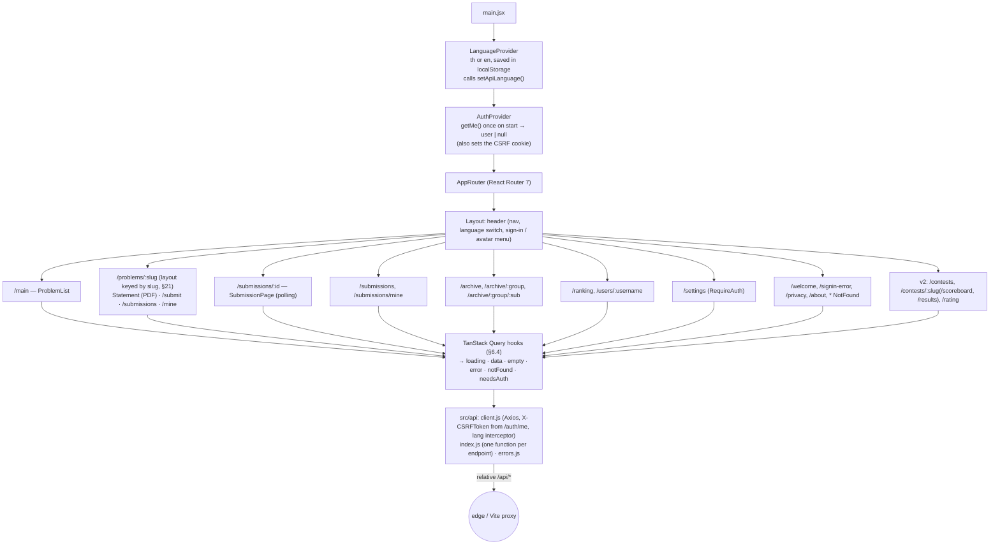

### 6.2 Folder layout

```
src/
├── api/
│   ├── client.js        # contract §4 + allowAbsoluteUrls: false (§17 F-03) + csrf_token from /auth/me (§40 #2)
│   ├── index.js         # getMe, listProblems, submitSource, submitFile, …
│   ├── errors.js        # toApiError(e) → {status, code, message, fields, retryAfter}
│   └── poll.js          # waitForResult + delay (contract §9) + bounded retry
├── auth/                # AuthProvider, useAuth, RequireAuth, signInUrl(next)
├── i18n/                # LanguageProvider, strings.th.js, strings.en.js (UI text)
├── hooks/               # useApi, usePolling, useRetryAfter
├── components/          # VerdictBadge, Pager, ProblemTable, FolderCard, Avatar, StatementPdf, RankName…
├── pages/
├── router/AppRouter.jsx
└── assets/              # self-hosted fonts (IBM Plex Sans Thai is already vendored in the prototype)
```

Delete: `src/apiHooks/`, `src/data/dataManager.jsx`, `src/controller/` (or turn it into
client-side validators), and the `dotenv` dependency (it is a Node library; Vite uses
`import.meta.env`, and this app needs no env at all because it only calls relative URLs).

### 6.3 Two kinds of language

| | Comes from | Example |
|---|---|---|
| UI text | `src/i18n/strings.*.js` in the frontend | "Submit", "Accepted", sign-in error messages |
| Content | API, via `?lang=` | problem titles, statements, group names, `title.name` |

When the user switches language: update both, `setApiLanguage()`, then refetch what is on screen
(simplest: include `lang` in each `useApi` dependency list).

### 6.4 Data fetching

**Use TanStack Query v5 (rev. 6, review F-5).** Rev. 1 said plain hooks were enough; they aren't.
The app needs polling, hidden-tab pause, 2/4/8 s back-off, `Retry-After`, `lang` in every cache key,
abort on unmount, and "refresh the score ring when a submission on another route finishes". TanStack
gives these directly (`signal`, `refetchInterval`, `refetchIntervalInBackground: false`,
`retryDelay`, `invalidateQueries(['problem', slug])`). Hand-written `useApi` hooks also trip
`eslint-plugin-react-hooks` v7's `set-state-in-effect` rule, which the repo already uses.

Frontend rules the reviews added:

- **Cancellation (F-4):** Axios rejects an aborted request with `CanceledError`, not `AbortError`.
  Use `isAbortish = e => axios.isCancel(e) || e?.name === 'AbortError'` everywhere; StrictMode in dev
  aborts the first poll every time, and treating it as a failure shows "Lost connection".
- **Error classes (F-13):** classify by **status code first**, then body. A Cloudflare 429 is HTML
  but still means "wait `Retry-After`", not "outage". Time "queued > 30 s" with `performance.now()`
  from first seeing `queued`, never against `created_at` and the device clock.
- **Ids and URLs (F-15):** check route ids against `/^\d+$/` before calling the API; accept API URLs
  (`url`, `pdfs`, `photo_url`) only if `new URL(u, location.origin)` is same-origin and starts with
  `/api/`; the single exception is the contest SSO URL, checked against `contest_origin`.
- **CSP from day one (F-11):** set Vite's `preview.headers` to the edge's exact CSP and run
  `vite build && vite preview` with a smoke check in CI from F0, so CSP breakage shows up in week 1,
  not M5. Exclude fonts from `build.assetsInlineLimit` (inlined fonts become `data:` URLs, which
  `font-src 'self'` blocks).
- **Stale chunks after a deploy (F-12):** listen for Vite's `vite:preloadError` and reload once,
  with a `sessionStorage` timestamp as the loop guard; use React Router data mode
  (`createBrowserRouter`, `lazy`, `errorElement`).
- **Dev env (F-14):** the dev `.env` sets `GRADER_PUBLIC_PROTO=http`, or Django thinks dev requests
  are HTTPS and Safari refuses the resulting `Secure` cookies on `http://localhost`.
- **Tests:** Vitest + Testing Library for hooks and components (polling under StrictMode, abort,
  error classes); the browser e2e tests stay in the backend repo.

---

## 7. Key flows

### 7.1 Google sign-in

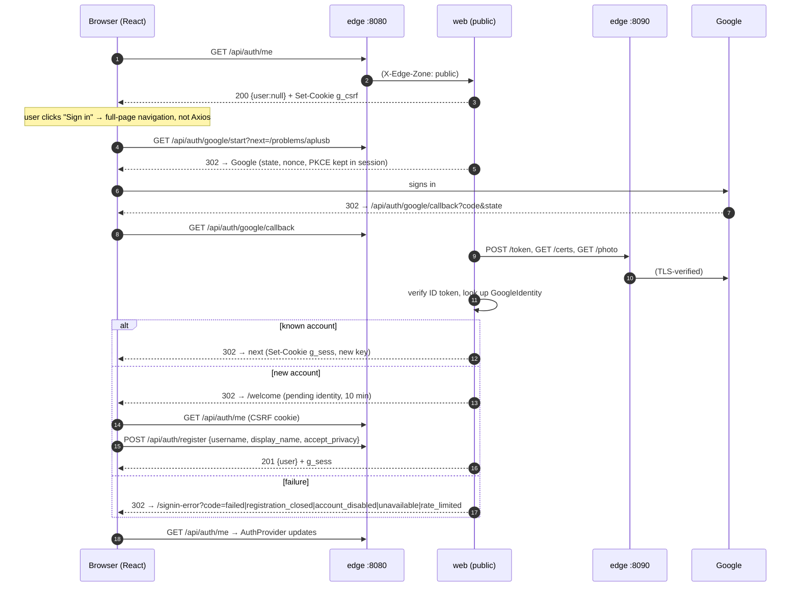

### 7.2 Submit and watch the result

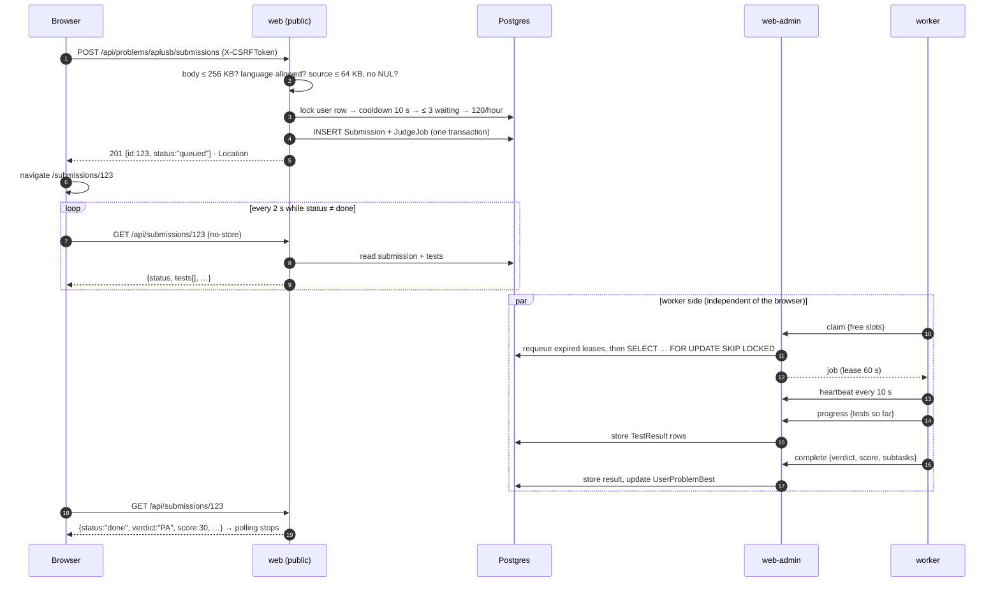

### 7.3 Submission lifecycle

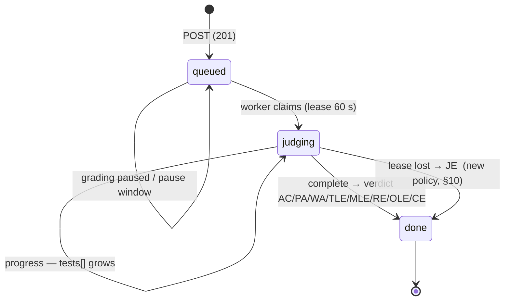

What the frontend renders per state is the contract's field table (§9): show only non-null,
non-empty fields.

### 7.4 Polling with bounded retry (proposal for the open decision)

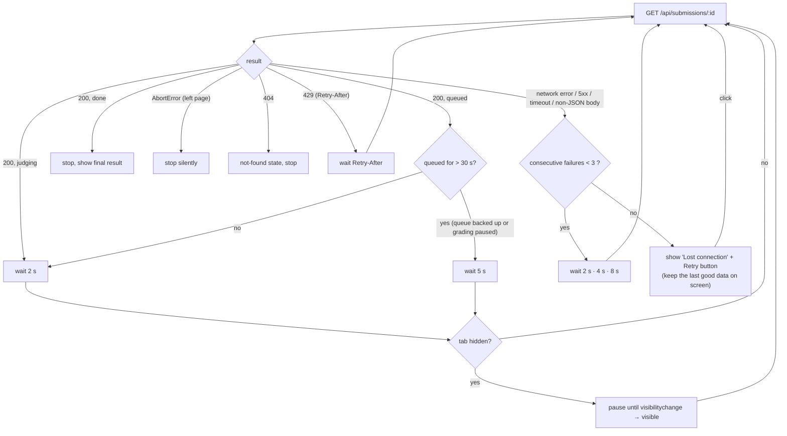

A successful response resets the failure counter. The two additions in rev. 2 (slower polling
for long-queued submissions, nothing while the tab is hidden) are the cheapest capacity fix in
this plan (§18); the 5 s step is a small change to the contract's "every 2 seconds" and must be
written into it.

---

## 8. Data model

Practice-site changes (v1): `Submission.max_score`, `User.privacy_accepted_at` / `privacy_version` (§10). Contest tables are in §33.

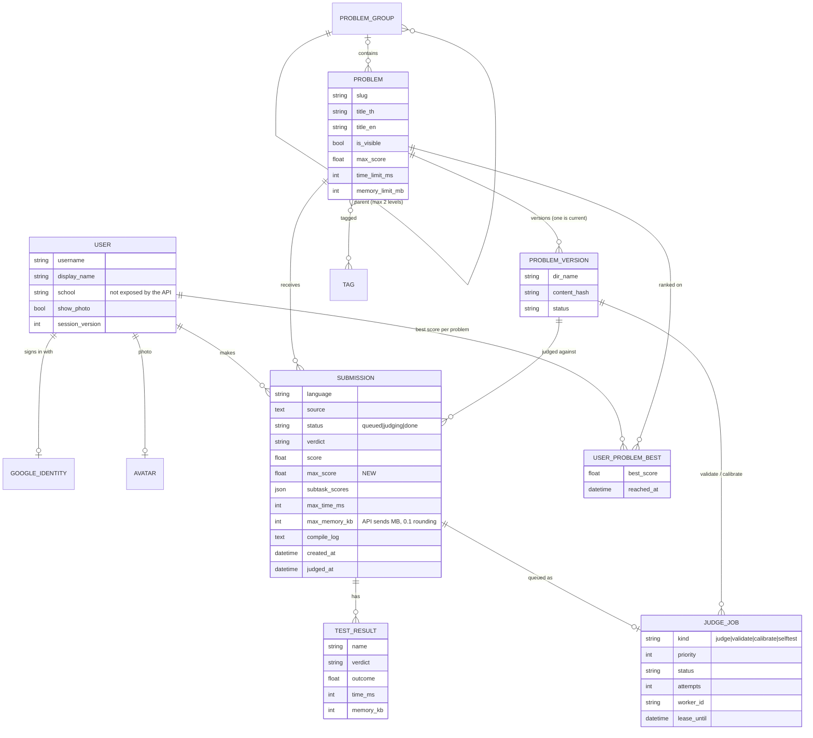

Also in `core` (not exposed to the SPA except via `/api/site`): `SiteSetting`, `PauseWindow`,
`AuditLog`, `RateLimitCounter`, `BackupRun`, `SetupToken`, plus the `Worker` table in `judging`.

---

## 9. Security model (what protects what)

| Threat | Protection | Layer |
|---|---|---|
| Public site reaching admin / judge API | Not in `urls_public.py` at all; edge blocks paths; `EdgeZoneMiddleware` 404s wrong zone | Django + edge |
| CSRF on POST/PATCH | `g_csrf` cookie ↔ `X-CSRFToken`, Origin check vs `PUBLIC_BASE_URL`, same-origin only (no CORS) | Django |
| Session theft / mix-up between roles | HttpOnly `g_sess`, Secure in prod, role mark on session, `session_version` for log-out-everywhere | Django |
| XSS via statements | PDFs open in the browser's own sandboxed viewer (§21); the HTML fallback is Markdown with raw HTML off → nh3 allow-list → only then `dangerouslySetInnerHTML` (one allowed file, ESLint `react/no-danger`); strict CSP as a second wall | Django + edge + React |
| XSS via user content | React escapes by default; never `dangerouslySetInnerHTML` for names, sources, compile logs (render in `<pre>`) | React |
| Open redirect | `next` must be a same-site path | Django |
| Leaking hidden tests | per-test time rounded to 10 ms, memory 0.1 MB; rate limits | Django |
| Leaking code | source + compile log author-only; others get 404 | Django |
| Abuse | body caps (edge 1 MB, API 256 KB), submit limits, sign-in/settings limits, `Retry-After` | edge + Django |
| Sandbox escape | isolate + own cgroup + seccomp `box-exec` + no network/DB for worker | worker |
| SSRF | `web` only reaches Google via edge `:8090` fixed paths | edge + networks |

---

## 10. Changes the contract requires in existing code

| # | Change | Where | Why |
|---|---|---|---|
| 1 | Add `Submission.max_score` (FloatField, null). New rows: store the worker's `JudgeResult.max_score`, which the worker already sends and `complete()` currently throws away (`internal.py`). **Backfill (review B-3):** `ProblemVersion` has no max score, so rows on the problem's current version copy `Problem.max_score`; others read their version's `problem.yaml` from the store, falling back to `Problem.max_score` if the folder is missing (CI has an empty store) | `judging/models.py`, `internal.py` + migration | Contract §14: old submissions keep the score they were judged out of |
| 2 | **Not** a global `MAX_ATTEMPTS = 1` (review B-4): that constant also governs `fail()` and validate/self-test jobs, so one transient error would mark a version invalid. Add `JUDGE_LEASE_ATTEMPTS = 1` used only when a `kind=judge` lease **expires**; keep 3 for `fail()` and non-judge jobs | `judging/internal.py` (+ tests, `test_m4_resilience.py`) | Contract §14 decision |
| 3 | Google redirect URI → `PUBLIC_BASE_URL + "/api/auth/google/callback"`; update it in Google Cloud Console and in fake-oidc | `accounts/google.py`, settings, `deploy/dev/fake-oidc`, admin Sign-in page text | New path |
| 4 | After sign-in: redirect new users to `/welcome`, failures to `/signin-error?code=` (no HTML message page) | `accounts/views.py` | SPA owns those pages |
| 5 | Page past the end → empty `results` (prototype returns last page) | `api/pagination.py` | Contract §11 |
| 6 | Bad list filter → `400` (prototype: empty list) | `SubmissionFilterForm` use in API view | Contract §9 |
| 7 | Language from `?lang=` instead of the `g_lang` cookie / `set_language` | `api/language.py`; drop `/i18n/` from public URLs | Contract §3 |
| 8 | Public role: remove templates, htmx, `ThaiByDefaultMiddleware` dependency on cookies, `/privacy` HTML | public URLs + templates | API-only |
| 9 | Edge serves SPA on `:8080` | `deploy/edge/Caddyfile`, `Dockerfile` | §3 |
| 10 | JSON for CSRF failure / 404 / 500 | `api/errors.py`, `config/urls_public.py` | Contract §12 |
| 11 | **Worker drain, designed (review O-4).** Today `stop()` only sets `_stop`; `run_forever` returns, the process exits and the job threads (`daemon=True`) die; the heartbeat thread also loops on `_stop`, so even joining the threads would let leases lapse. New: a separate `_draining` flag (stop claiming) while heartbeats **keep running**; join job threads up to a **120 s** deadline; then `POST /internal/release` for jobs still running (requeued, no try counted); `stop_grace_period: 150s` (not 15 m, which would stall every `compose up`). On `hello`, web-admin requeues jobs still leased to the **same `worker_id`** without counting a try — the hostname is fixed, so this also covers a crash or a host reboot that killed the worker before it could drain | `client.py`, `internal.py`, compose | With `JUDGE_LEASE_ATTEMPTS = 1`, deploys and reboots would otherwise produce `JE` (§17 F-02) |
| 12 | `StrictSessionAuthentication` (CSRF on every unsafe request, 401 when signed out) | `api/auth.py` | §5.4, §17 F-01 |
| 13 | `ApiBodyLimitMiddleware` right after `EdgeZoneMiddleware`, plus the WSGI de-chunker (§5.4) | `api/middleware.py`, `config/wsgi.py` | Body is parsed during auth, before the view's check (§17 F-05) |
| 14 | `Cache-Control: no-store` default on `/api/*` | `api/middleware.py` | Per-user data on shared computers (§17 F-08) |
| 15 | Record consent: `User.privacy_accepted_at`, `User.privacy_version` | `accounts/models.py` + migration | Today only a form checkbox; nothing proves consent later (§19) |
| 16 | Daily clean-up: `clearsessions`, delete `RateLimitCounter` rows older than their window | `deploy/ops` backup loop (already runs daily) | I found no clean-up of either table; anonymous sign-in starts create sessions forever (§17 F-14) |

---

## 11. Milestones

> **Superseded by §42 (rev. 6).** The Gantt below counts calendar days for full-time work; the
> delivery review re-estimated in focus hours for two part-time people. Kept for the task lists.

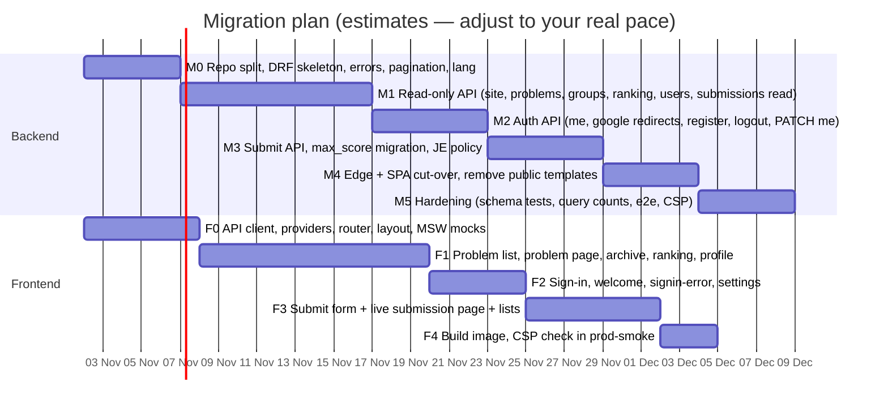

### M0 — Foundations (both repos)
- [ ] Push prototype history into `Kit2Code/backend`; archive `grader_prototype`.
- [ ] Branch protection + required review on both repos; Actions pinned by commit SHA; Renovate or
      Dependabot; lockfile diffs reviewed like code (F-09, S-11).
- [ ] Add `djangorestframework`, `drf-spectacular` (uv lock).
- [ ] `web/api/`: `auth.py` (`StrictSessionAuthentication`, F-01/F-04/S-9), `errors.py` (mapping
      table, B-11), `pagination.py` (B-10), `language.py` (after `LocaleMiddleware`, B-2),
      `middleware.py` (body limit after EdgeZone, `no-store` default — F-05/F-08), UTC base
      serializer (B-1), JSON + multipart parsers only where needed (F-26).
- [ ] `config/wsgi.py` de-chunker (O-2).
- [ ] `__Host-` cookie names in production + `csrf_token` in `/api/auth/me` (F-20/S-2).
- [ ] Mount `api/` in `urls_public.py` **alongside** the old pages (no cut-over yet).
- [ ] Generate `docs/openapi.yaml` in CI with `--urlconf api.urls` (F-12); fail CI if it changes
      without being committed. Apply §40's v1 contract changes to the contract.
- [ ] Frontend F0 (§42 "start today"): API client with `allowAbsoluteUrls: false` (F-03), URL and
      id checks (F-21/F-15), TanStack Query, providers, router (data mode), layout, Vite proxy,
      `vite preview` with the production CSP in CI (F-11 frontend), MSW mocks, Vitest.

### M1 — Read-only API
- [ ] Extractions first (§5.3, B-8): archive services, `Folder.id/slug`, signed-out `null` counts.
- [ ] `/api/site`, `/api/problems`, `/api/problems/{slug}` (+ `my_best`, `status`), `/files/{name}`
      (`?v=`, `private` cache, framing header for statement PDFs — §21.3).
- [ ] `/api/groups`, `/api/groups/{slug}[/{sub}]` (incl. `other`, `problems: null` rule).
- [ ] `/api/submissions` (+ `problem` filter on `/mine`), `/api/submissions/{id}` (serializer
      rules, B-5), `/source`.
- [ ] `/api/ranking`, `/api/users/{username}`, `/photo`.
- [ ] Tests: signed-in vs signed-out shapes, hidden → 404, file allow-list, every timestamp ends in
      `Z`, pagination edge cases, poll endpoint ≤ 4 / ≤ 2 queries (B-6).

### M2 — Auth
- [ ] `/api/auth/me` (always 200, `csrf_token`), `google/start`, `google/callback` redirects.
- [ ] `/api/auth/register`, `/logout` (frontend does a full page load after it, F-08),
      `/logout-everywhere`, `PATCH /api/me`.
- [ ] Consent fields `privacy_accepted_at`, `privacy_version` (F-15).
- [ ] New redirect URI in fake-oidc; in Google Cloud **added next to the old one** a week before
      M4a (F-16).
- [ ] Tests: every unsafe route has `StrictSessionAuthentication` (route walk); CSRF code is
      `csrf_failed`; open-redirect attempts; register errors.

### M3 — Submitting and the judge
- [ ] Extract `judging/services.create_submission()` and `_limit_reached → (code, retry_after)`.
- [ ] JSON and multipart bodies; 413 before parsing; 429 codes with `Retry-After`.
- [ ] Migration `Submission.max_score` + backfill (B-3); store `JudgeResult.max_score`.
- [ ] Worker drain (§10 #11, O-4) **and** `JUDGE_LEASE_ATTEMPTS = 1` (§10 #2, B-4) in the same
      release; e2e: SIGTERM mid-judge ⇒ not `JE`; lease expiry ⇒ `JE`.
- [ ] Frontend F3: submit form (`<textarea>` + upload, F-22), submission page with polling (§7.4,
      F-11 frontend half: slow-down, hidden-tab pause).

### M4a — Cut-over (old pages still in the image)
- [ ] Edge tests written **first** (§3.2), then the new `:8080` block; edge `mem_limit` 96m → 192m
      (O-7); `grader-site` image built on tag, digest pinned in the edge Dockerfile.
- [ ] Router redirect map for old URLs (F-17); chunk-reload guard (F-18, F-12 frontend).
- [ ] HSTS on the public hostname in Cloudflare (F-10); Cloudflare cache rule "bypass `/api/*`" (S-7).
- [ ] Rewrite `web/tests/e2e/` public flows against the SPA (Playwright: sign-in → submit → result).
- [ ] `scripts/prod-smoke.sh` through the **real tunnel**: SPA route, JSON 413, blocked paths,
      submits (JSON, multipart, chunked).
- [ ] **Load test before switching** (O-8): k6 or Locust against the production compose on the NAS,
      150 open submission pages + 20 req/s browsing; budget in CPU-seconds on CPU 3, record p95.
- [ ] Switch `GOOGLE_REDIRECT_URI`; switch the tunnel; watch for a day.

### M4b — Clean-up (after two stable weeks)
- [ ] Remove public templates, views, htmx, `/i18n/`, `LocaleMiddleware` on the public role; keep
      admin templates and static files (F-25).
- [ ] Remove the old Google redirect URI.
- [ ] Update `docs/ARCHITECTURE.md` and `DEPLOY.md`; split this plan (§41).

### M5 — Hardening (v1.1)
- [ ] Contract checklist (§15 of the contract) all ticked.
- [ ] PDF-only enforcement in importer, editor and publishing (§21.4).
- [ ] PDPA: consent re-prompt endpoint, deletion and export commands (§19, B-13).
- [ ] Daily `clearsessions` + rate-limit counter prune (F-14).
- [ ] Monitoring: external uptime check, worker-claim alert, disk and backup-age alerts (F-23, O-11);
      Cloudflare rate rule on `/api/*` (F-24).
- [ ] Accessibility pass; real-device matrix including an iPad (F-1).
- [ ] Bundle size budget; code-split heavy pages.
- [ ] Every finding in §17 closed or explicitly accepted in writing.

---

## 12. Gaps found while reading the code (not covered by the contract yet)

1. **How `dist/` reaches production.** The contract says "Caddy serves `dist/`" but not how the
   files get into the edge image. Proposal: §3.3.
2. **`Submission` has no `max_score` column today.** The contract's recommended policy needs a
   migration and a backfill (§10 #1).
3. **`MAX_ATTEMPTS = 3`** in `judging/internal.py` — see §10 #2 (a separate
   `JUDGE_LEASE_ATTEMPTS`, not a global change) and the worker drain, §10 #11.
4. **Code editor vs. CSP** — see §17 F-22.
5. **Vite proxy must keep the Host header** (`changeOrigin` off), otherwise Django rejects the
   host and CSRF origin in dev (§4).
6. **SameSite must stay `Lax`.** `Strict` would drop the session on the Google callback and every
   sign-in would fail with `failed`.
7. **Language of error messages on POST/PATCH.** The contract only localizes `GET`. Proposal: the
   Axios interceptor adds `lang` to every request, and `ApiLanguageMiddleware` reads it on all
   methods, so validation messages match the UI.
8. **Privacy page.** Registration requires `accept_privacy: true`, and the prototype has a
   `/privacy` page, but the contract's route table has no `/privacy`. The SPA needs one (static
   content in the frontend) and `/welcome` must link to it.
9. **Rejudge while someone is watching.** If an admin rejudges a `done` submission, a page that
   already stopped polling shows stale data. Acceptable for v1; a "Refresh" button is enough.
10. **Old e2e and template tests.** `web/tests/e2e/test_m3_flow.py`, `test_m4_judging.py`,
    `test_home_page.py`, `test_design.py`, `test_i18n.py` test HTML pages; they must be rewritten
    or deleted at cut-over, or CI will block M4.
11. **Polling load** — see §17 F-11 and §18.
12. **SPA 404s are HTTP 200.** Unknown frontend routes return `index.html`. That is normal for a
    SPA; only the API speaks real 404s. Search engines are not a goal here, so no SSR needed.

---

## 13. Open decisions — recommended answers

| Decision | Recommendation |
|---|---|
| Polling retry after network errors | §7.4: 3 consecutive failures with 2/4/8 s back-off, then a visible error + Retry button; aborts are silent; keep last good data on screen |
| Score after a new problem version | Keep `UserProblemBest` rows; "solved" = full marks on the **current** version (as the prototype does); store `max_score` on each submission so old results still display correctly; admin can rejudge to recompute |
| Crash policy | Lost lease on a judge job ⇒ `JE` (`JUDGE_LEASE_ATTEMPTS = 1`, §10 #2); `fail()` and non-judge jobs keep 3 tries; keep lease, heartbeat and stale-write rejection. **Only together with the worker drain (§10 #11)** — a planned restart is not a crash and must never produce `JE` |
| Missing `Content-Length` on unsafe `/api/*` | Accepted: the WSGI de-chunker reads chunked bodies (§5.4); no `411` code |
| Polling slow-down | 2 s while judging; 5 s once a submission has been queued 30 s; paused while the tab is hidden — add to contract §9 |
| Error-message language for POST | Send `lang` on every request (§12 #7) |
| Delivery of `dist/` | `grader-site` image pinned by digest into the edge (§3.3) |

---

## 14. CI / release

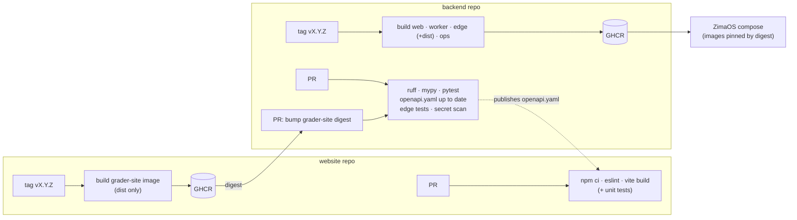

---

## 15. Stack summary

| Layer | Technology | Repo |
|---|---|---|
| UI | React 19, React Router 7, React Compiler, Vite 8, Axios | website |
| Static hosting + reverse proxy | Caddy (grader-edge) | backend |
| Tunnel / TLS / remote admin auth | Cloudflare Tunnel + Access | infra |
| API | Django 5.2 + Django REST Framework + drf-spectacular | backend |
| Admin UI | Django admin + custom server-rendered pages (htmx) | backend |
| Auth | Google OpenID Connect (code + PKCE), Django sessions | backend |
| Database + job queue | PostgreSQL | backend |
| Judge | Python worker + isolate 2.7 + seccomp launcher | backend |
| Shared code | `grader_common` (problem format, scoring, importer) | backend |
| Contests | CMS 1.5.1, inside the compose stack (§37) | backend |
| Deployment | Docker Compose on ZimaOS, images on GHCR | backend |

---

# Part 2 — Hostile review (rev. 2, 2026-10-28)

Everything below came from re-reading rev. 1 as an attacker and as the person on call, and
checking each claim against the prototype's code (`judging/views.py`, `judging/internal.py`,
`judge/worker/src/grader_worker/client.py`, `core/ratelimit.py`, `problems/files.py`,
`accounts/google.py`, `config/settings.py`, the ZimaOS compose file) and DRF's documented
behaviour. Several holes were in **my own rev. 1 sketches**, not in the prototype; they are marked.

## 16. Rating

| Area | Rev. 1 | Rev. 2 | Why |
|---|:---:|:---:|---|
| Architecture | 8 | 8.5 | Sound: keeps the prototype's zones, networks and sandbox; SPA adds no new service |
| Security | 6 | 8.5 | Rev. 1's DRF settings would have shipped anonymous POSTs without CSRF, wrong 401/403, body parsed before the size check; HSTS lost on HTML |
| Contract fidelity | 6 | 8.5 | Edge-made errors weren't JSON; 401 vs 403; `UNAUTHENTICATED_USER` bug |
| Reliability / operations | 5 | 8 | `JE` on every worker restart; no capacity math; no rollback; tables never pruned; no alerting |
| Delivery plan | 7 | 8 | Milestones fine; cut-over and template removal were in one step (no way back) |
| **Overall** | **6.5** | **8.5** | |

**What stops it at 8.5 is accepted, not overlooked:** one home server, one Postgres, one ISP line,
CPU shared with CMS, polling instead of push. Those are product constraints. Nothing in §17 is left
open without a fix or an explicit "accept".

**Already strong in the prototype — don't "fix" these:** the zone header + separate URLconfs;
secrets as files; `safe_next` (rejects `//`, `/\`, control characters); the file allow-list with
its own content-type table (HTML/SVG can't be served inline, only PDF opens in the browser); nh3
after Markdown with raw HTML off; the `Cc`+`Cf` check on names (blocks bidi-override tricks); the
row lock before the submit limits; time/memory rounding; the worker with no DB and no internet.

## 17. Findings register

Severity: **H** = exploitable or loses user data/results; **M** = real weakness or contract break;
**L** = hardening. "Mine" = the hole was in rev. 1 of this plan.

| ID | Sev | Finding | Fix | When |
|---|:---:|---|---|---|
| F-01 | H | *(Mine)* Stock DRF `SessionAuthentication` checks CSRF only for signed-in users, and `APIView` is `csrf_exempt`. `POST /api/auth/register` runs with no CSRF check. Same-site siblings (CMS, `admin.<domain>`) aren't stopped by `SameSite=Lax` | `StrictSessionAuthentication` (§5.4); test that every unsafe endpoint returns `csrf_failed` without a token | M0 |
| F-02 | H | A lease-expiry `JE` policy + job threads that are `daemon=True` + Docker's short default stop timeout ⇒ every worker update, `compose up` or NAS reboot would turn running submissions into `JE` | Worker drain as designed in §10 #11 (separate `_draining`, heartbeats kept, 120 s deadline, `/internal/release`, same-`worker_id` requeue on `hello`, `stop_grace_period: 150s`); e2e test: SIGTERM mid-judge ⇒ not `JE` | M3, same release as `JUDGE_LEASE_ATTEMPTS = 1` |
| F-03 | L | Any API helper that receives an absolute URL (e.g. a slug that is really `https://evil`) sends the request off-site | `axios.create({ …, allowAbsoluteUrls: false })` (Axios ≥ 1.8); always `encodeURIComponent` path parts | M0 |
| F-04 | M | *(Mine)* Signed-out requests get 403, not the contract's 401 | `authenticate_header` in `StrictSessionAuthentication` | M0 |
| F-05 | M | *(Mine)* "413 before body parsing" is false under DRF: CSRF reads `request.POST`, which parses multipart first; missing `Content-Length` counts as 0 | `ApiBodyLimitMiddleware` after EdgeZone + WSGI de-chunker (rev. 6, §5.4; the 411 idea was dropped) | M0 |
| F-06 | M | Edge streams request bodies to gunicorn (2 workers × 4 threads). Eight slow uploads stall the whole public site | `request_buffers 2MB` (above `max_size`, tested) on the `/api/*` proxy (§3.2) | M4 |
| F-07 | M | Edge-made errors (413 over 1 MB, 502/504 while `web` restarts) have empty/text bodies; Cloudflare's 52x pages are HTML. The contract's error helper would crash or show nothing | `handle_errors` JSON on `/api/*` (§3.2); frontend `errors.js` treats any non-JSON body as `server_error` | M4 |
| F-08 | M | Per-user API answers have no `Cache-Control`; shared school PCs can show the last student's data via back/bfcache after logout | `no-store` default on `/api/*`; after logout do a full page load (`window.location.assign('/main')`), not a client-side navigate, so memory state is gone too | M0 |
| F-09 | M | The `website` repo can put JavaScript on the same origin as the session. A compromised dependency or account can then act as any student who loads it (submit, rename, read their own sources) | Branch protection + required review on both repos; Actions pinned by commit SHA; `npm ci --ignore-scripts`; Dependabot/Renovate; the `grader-site` digest bump is a backend-repo PR the backend owner reviews; ESLint `react/no-danger` with one allowed file; never run `vite --host` on untrusted networks | M0 (day one) |
| F-10 | L | HSTS used to come from Django on every page; HTML now comes from Caddy | HSTS in Cloudflare for the public hostname; Django keeps it on `/api/*` | M4 |
| F-11 | H | Capacity: the public role is 8 request slots on CPU 3, which also runs Postgres, web-admin, edge, ops and the worker process. Polling every 2 s turns 100 open result pages into 50 req/s — about the whole budget | Backend: poll endpoint ≤ 4 queries signed in, no session write (M1). Frontend: polling slow-down + hidden-tab pause (F3). Load test on the NAS **before** M4a (§18) | M1 + M3 + M4a |
| F-12 | L | *(Mine)* Swagger UI planned on the admin role would document the admin URLconf and load from a CDN the CSP blocks | CI-only generation with `--urlconf api.urls`; `drf-spectacular-sidecar` in dev | M0 |
| F-13 | M | *(Mine)* `"UNAUTHENTICATED_USER": None` breaks reused code that reads `request.user.is_authenticated` | Removed (§5.4) | M0 |
| F-14 | M | No clean-up found for `django_session` or `core_ratelimitcounter`. Every anonymous `google/start` creates a session row (rate-limited per IP, but IPs are cheap) | Daily `clearsessions` + counter prune in the ops loop (§10 #16) | M5 |
| F-15 | M | Consent is a form checkbox only: no time, no version. No deletion or export path. Most users are students under 20 | §19 | M2 (fields), M5 (process) |
| F-16 | M | The Google redirect URI changes path at cut-over; if it changes in Google Cloud and the deploy rolls back (or the reverse), nobody can sign in | Register **both** URIs in Google Cloud a week before; remove the old one two weeks after | M4 |
| F-17 | L | Old links and bookmarks (`/problems`, `/auth/welcome`, `/submissions/<id>/results`) land on the SPA's not-found page | Small redirect map in the router (`/problems` → `/main`, etc.); also `/` → `/main` (the backend's default `next` is `/`) | M4 |
| F-18 | L | After a deploy, an open tab asks for old hashed chunks that no longer exist ⇒ blank page on lazy routes | Catch chunk-load errors once and reload the page; keep `/assets/*` 404 (never fall back to `index.html` for assets, or the browser gets HTML as JS) | M4 |
| F-19 | L | Photos are `Cache-Control: public, max-age=3600`: a photo a user hides can stay in browser caches for an hour | Accept, but say so on the settings page; never add a Cloudflare "cache everything" rule on `/api/*` | M4 |
| F-20 | **H** (raised in rev. 6) | Same-site siblings can **plant cookies** for the parent domain. Rev. 2 only considered `g_csrf`; review S-2 showed the worse case: a sibling page with an XSS (e.g. `contest.domain`, which now allows inline scripts) sets `g_sess=<attacker's session>; Domain=.domain`; Django keeps the last of two same-name cookies, so the victim is silently signed in as the attacker and submits into their account | **`__Host-` cookie prefix in production** (`__Host-g_sess`, `__Host-g_csrf`: Secure, path `/`, no `Domain` — a sibling can't set them). Names come from env per role (`config/env.py`), so dev keeps plain names. So the frontend never hard-codes the cookie name, `GET /api/auth/me` also returns `csrf_token`, and the Axios interceptor sends it as `X-CSRFToken` (contract change). Plus HSTS with `includeSubDomains` on the apex domain, so a plain-HTTP sibling can't be used to set cookies either | M0 |
| F-21 | L | The SPA follows URLs it is given (`url`, `pdfs`, `photo_url`, the contest SSO URL) | Accept a URL only if `new URL(u, location.origin)` is same-origin and starts with `/api/`; the single exception is the contest URL, checked against `contest_origin` (§25.3). React 19 already blocks `javascript:` | M0 |
| F-22 | M | Code editors (CodeMirror, Monaco) and CSS-in-JS inject styles at run time; the edge CSP (`style-src 'self'`) may block them | `<textarea>` + file upload first; any editor is tested under the production CSP before adoption; CSP relaxation is the backend owner's call | M3 |
| F-23 | M | No alerting: if the tunnel, `web`, every worker, the scheduler or CMS is down, nobody knows until students complain | External uptime check on `https://<public>/api/site` and `contest.domain`; alerts when no worker has claimed for 5 min, the scheduler heartbeat is older than 60 s, CMS's evaluation queue is stuck (bridge `/health`), disk is low or the newest backup is older than 26 h (O-11) | M5, contest parts in v2a |
| F-24 | M | No limit on GET floods (search, ranking, polling). The Postgres rate limiter writes a row per hit, so it must not be used for reads | One Cloudflare rate-limiting rule on `/api/*` per IP (e.g. 300 req/min); keep the DB limiter for writes only | M5 |
| F-25 | M | Rev. 1 removed public templates in the same release as the cut-over ⇒ no rollback | Split M4: M4a cut-over (old pages still in the image), M4b remove templates after 2 stable weeks; migrations expand-only (§20) | M4 |
| F-26 | L | The JSON parser is on every endpoint and the multipart parser everywhere too | Multipart only on the submit view (`parser_classes`), JSON elsewhere; smaller attack surface, clearer 415s | M0 |

### Trust boundaries

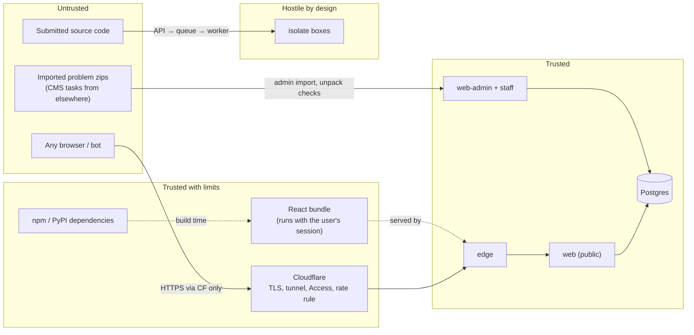

The two arrows that rev. 1 did not think about: **dependencies → SPA** (F-09) and **planned
restarts → worker** (F-02).

## 18. Capacity — the real bottleneck

Assumptions (measure in M5; these are estimates, not measurements):

| Item | Value | Source |
|---|---|---|
| Public role concurrency | 2 gunicorn workers × 4 threads = 8 | `web/docker-entrypoint.sh` |
| CPU for all services | 1 core (CPU 3), shared by db, web, web-admin, edge, ops, worker process | ZimaOS compose `cpuset: "3"` |
| Cost of one poll | ~5–10 ms CPU (session, user, submission, tests) | estimate |
| Usable public API rate | ~50 req/s after Postgres and the rest take their share | estimate |

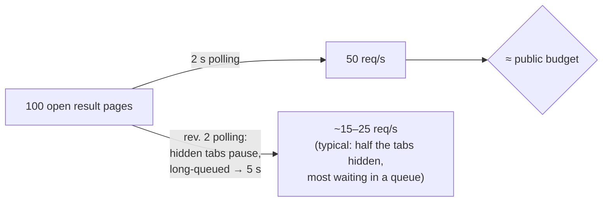

Fixes, cheapest first:

1. Polling slow-down and hidden-tab pause (§7.4).
2. `GET /api/submissions/{id}` in ≤ 4 queries signed in and ≤ 2 anonymous (rev. 6, review B-6:
   session + user + submission + tests can't be 3), pinned with `assertNumQueries`; no `COUNT`; **no session write** (no
   `Set-Cookie` on polls) — add a query-count test like the existing `EXPLAIN` tests.
3. `--threads 8` for the public role if the load test shows threads waiting, not CPU.
4. Give the services a second CPU if one is free (DEPLOY.md already explains how).
5. Judge throughput is separate: 2 sandbox CPUs. On busy days the queue grows, not the web load —
   that is what the 5 s step is for.
6. Run the load test **before** M4a, not in M5 (review O-8): the numbers above are estimates, and two
   GIL-bound gunicorn processes share CPU 3 with Postgres, cloudflared, the edge and the worker
   process, so 8 threads are not 8-way parallelism. Budget in CPU-seconds, not threads.

Not recommended now: SSE/WebSockets. With threaded gunicorn every open stream holds one of the 8
threads, which is worse than polling.

## 19. Privacy (Thai PDPA)

This is engineering input, not legal advice — have someone who knows the PDPA check the privacy
page, especially for students under 20 (Thailand's age of majority) and whether parental consent
is needed for younger ones.

| Data | Where | Public? |
|---|---|---|
| Google account id (`sub`) | `GoogleIdentity` | never |
| Display name, username, photo | `User`, `Avatar` | yes (profile, ranking, lists) |
| School | `User` | not via the API |
| Every submission's code | `Submission.source` | author only |
| Submission timeline (what, when, verdict) | `Submission` | **yes** — anyone can list one user's activity |
| IP addresses | hashed in rate-limit keys; plain in `AuditLog` (staff actions only) | no |
| All of the above | nightly backups | no |

Engineering changes:

1. Store `privacy_accepted_at` and `privacy_version`. `/api/auth/me` returns
   `needs_privacy_consent: true` for existing users with no consent on record and after the privacy
   page changes; the SPA shows the privacy page and calls `POST /api/me/privacy` (review B-13).
   Until consent is given, the user can browse but not submit.
2. Deletion procedure (admin action + script): delete photo and Google link, replace display
   name, disable the account; decide whether submissions are deleted or anonymised (anonymised
   keeps the ranking history consistent). In v2 the same action calls the bridge to anonymise the
   user's CMS account (C-11).
3. Export on request: a management command that writes one user's data as JSON.
4. State on the privacy page how long backups are kept, since deleted data lives there until the
   backups rotate.
5. Consider a "hide me from public lists" setting later; submission timelines of minors are
   public by default today.

## 20. Rollout and rollback

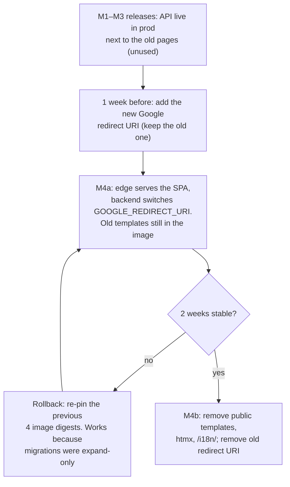

Rules that keep rollback possible:

- **Expand-only migrations** until M4b: new columns nullable or with defaults (`max_score`,
  `privacy_*`); nothing renamed or dropped. Old code runs on the new schema.
- The worker drain (F-02) ships **before or with** `JUDGE_LEASE_ATTEMPTS = 1`, never after.
- Keep the last two releases' digests in `DEPLOY.md` so a rollback is copy-paste in ZimaOS. The
  rollback table lists **every** image: `grader-web`, `grader-worker`, `grader-edge` (with the
  pinned `grader-site`), `grader-ops`, and from v2 `grader-cms`.
- **Every deploy is a short outage** (one edge, one tunnel). Run two `cloudflared` replicas so a
  tunnel restart doesn't drop the site, deploy outside school hours, and never deploy from T−24 h to
  the end of a contest (pre-flight checks the freeze, §31).
- Run `scripts/prod-smoke.sh` on every release candidate; extend it with: SPA route returns
  `index.html`, `/api/x` is JSON, a 2 MB POST gets JSON 413, `/assets/missing.js` is 404,
  SIGTERM during judging does not produce `JE`.

---

# Part 3 — Problem page and PDF statements (rev. 3, 2026-10-28)

**Decision:** every problem's statement is a PDF. The problem page shows it inside the site with
the **browser's own PDF viewer** in an `<iframe>`, next to a sidebar (layout below). No PDF
library is bundled.

## 21. Problem page

### 21.1 Layout

```
┌───────────────────────┬──────────────────────────────────────────────────────┐
│ ☆ A+B Problem         │  [ TH | EN ]                         [ Open PDF ↗ ]  │
│   #1 · 1 s · 64 MB    ├──────────────────────────────────────────────────────┤
│───────────────────────│                                                      │
│ ▸ Statement           │                                                      │
│   Submit              │      <iframe src="/api/problems/aplusb/files/        │
│   Submissions         │               statement/th.pdf?v=3f9a1c2e">          │
│   My submissions      │                                                      │
│   (Solution — v2)     │      browser's built-in viewer: zoom, page,          │
│───────────────────────│      download, print come for free                   │
│   Your score          │                                                      │
│     ( 100 / 100 )     │                                                      │
│───────────────────────│                                                      │
│   (Report — v2)       │                                                      │
└───────────────────────┴──────────────────────────────────────────────────────┘
```

| Sidebar item | Frontend route | API | Status |
|---|---|---|---|
| Statement | `/problems/:slug` | `GET /api/problems/{slug}` | ✓ contract |
| Submit | `/problems/:slug/submit` | `POST /api/problems/{slug}/submissions` | ✓ contract |
| Submissions | `/problems/:slug/submissions` | `GET /api/submissions?problem={slug}` | ✓ contract |
| My submissions | `/problems/:slug/mine` | `GET /api/submissions/mine?problem={slug}` | **add `problem` filter** (§21.5) |
| Your score ring | (sidebar, every tab) | `my_best`, `max_score`, `status` on problem detail | **add fields** (§21.5) |
| ☆ favourite | – | – | v2 (§21.6) |
| Solution | – | – | v2 (§21.6) |
| Report | – | – | v2 (§21.6) |

The sidebar and score ring come from one `GET /api/problems/{slug}` held by a parent route
(React Router `<Outlet>`); switching tabs doesn't refetch it. After a submission finishes `done`,
refetch it so the ring updates.

### 21.2 How the PDF is chosen and shown

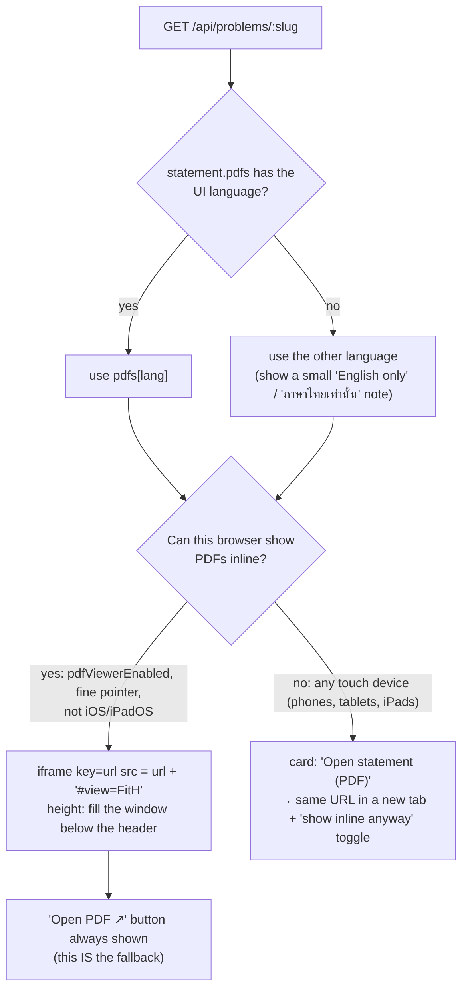

Rules for the frontend:

- **Inline only on desktop-class browsers (review F-1):** show the iframe when
  `navigator.pdfViewerEnabled` is true **and** `matchMedia('(pointer: fine)')` matches **and** it is
  not iPadOS (`navigator.maxTouchPoints > 1` on a "Mac" platform). Rev. 3's "coarse pointer and
  ≤ 768 px" let iPads (768–1366 px) and landscape phones through; iOS/iPadOS WebKit shows only the
  first page of an embedded PDF, and `pdfViewerEnabled` is true there. Everyone else gets the card,
  plus a "show inline anyway" toggle. Verify on a real iPad in M5.
- **No "iframe failed" branch (review F-2):** an iframe fires `load` even for an HTTP error or a
  download, never `error`. The always-visible "Open PDF ↗" button is the fallback.
- **`<iframe key={url}>` and a layout keyed by `slug` (review F-3):** changing an iframe's `src` adds
  a browser-history entry, so Back would step inside the iframe; a new element per URL does not.
- **TH | EN toggle** appears only when both PDFs exist. It switches the iframe without changing the
  site language.
- Use the `url` from the API exactly as given (it carries `?v=`). Never build file paths.
- Use `<iframe>`, never `<object>`/`<embed>`: the CSP has `object-src 'none'`.
- `#view=FitH` (fit width) is a viewer hint: Chrome and Edge follow it; others ignore it safely.
- Give the iframe a `title` (e.g. "Problem statement: A+B Problem") for screen readers.
- Samples still come as `samples[]` in the API. Show them under the viewer with a "copy" button —
  copying from inside a PDF is unreliable (spaces and line breaks get lost).

### 21.3 Backend and edge changes (required — without them the iframe is blank)

Today every response forbids framing, even by the site itself: Django's
`XFrameOptionsMiddleware` sends `X-Frame-Options: DENY`, and the edge sends `X-Frame-Options: DENY`
plus CSP `frame-ancestors 'none'`. Open it **only** for statement PDFs:

| Where | Change |
|---|---|
| `problem_file` API view | `@xframe_options_sameorigin` when the name is `statement/th.pdf` or `statement/en.pdf`; every other file keeps `DENY` |
| Edge `:8080` | For `^/api/problems/[a-z0-9_-]+/files/statement/(th\|en)\.pdf$` send `X-Frame-Options: SAMEORIGIN` and the normal CSP with `frame-ancestors 'self'` instead of `'none'`. Use the `header` directive with `defer`, so the edge's value replaces Django's instead of being added next to it |
| `deploy/tests/test_edge.py` | A statement PDF gets `SAMEORIGIN` + `frame-ancestors 'self'`; an attachment, `/api/site`, `index.html` and the admin ports still get `DENY` + `'none'` |
| Problem detail serializer | PDF URLs carry the version: `…/statement/th.pdf?v=<first 8 of content_hash>` |
| Problem file view | Statement PDFs: `Cache-Control: private, max-age=31536000, immutable` — **private** (review S-7): `.pdf` is cached by Cloudflare by default, so `public` would keep a problem that was published by mistake and hidden again downloadable from the CDN for a year. Also add a Cloudflare cache rule "bypass cache for `/api/*`". Don't add a CSP `sandbox` to the PDF: Chrome refuses to show PDFs in a sandboxed frame |

Why opening framing this narrowly is safe: `frame-ancestors 'self'` still stops any other site
from framing the PDF, and the PDF has no buttons or forms worth clickjacking. The HTML pages, API
and admin site stay unframeable.

### 21.4 "Always a PDF" — enforce it where problems are made

Scheduling (rev. 6, review D-4): every native fixture in the prototype has only Markdown statements,
so enforcing "always PDF" is on v1's critical path for no launch benefit. **v1:** the problem page
shows the PDF; if a problem has no PDF (fixtures, tests), it falls back to the sanitized HTML the
contract already defines. **v1.1:** the enforcement below, plus PDF versions of the fixtures.

- **Publishing rule** (`problems/publishing.py`): a version without at least one of
  `statement/th.pdf` or `statement/en.pdf` cannot be published. The admin Problems page shows why.
- **Importer** (`common/grader_common/importer/native.py`): report a missing statement PDF as an
  error, so validation fails before anyone tries to publish. CMS Italian-format tasks already have
  PDF statements.
- **Admin editor** (`problems/editor.py`): make the PDF upload required; the Markdown statement box
  can stay for admin notes but is no longer shown publicly.
- **API**: keep `statement.html` in the response so the contract doesn't break; after v1.1 it is
  always `""` for published problems.
- **Size**: cap a statement PDF at 10 MB in the importer; it travels through the tunnel to every
  student.
- **Untrusted PDFs**: imported zips can come from anywhere. The browser's own viewer runs PDFs in
  its sandbox and is patched with the browser, which is the main reason this plan uses it instead of
  bundling PDF.js.

### 21.5 Contract changes (add to the API contract)

1. `GET /api/problems/{slug}` adds, when signed in: `my_best` (number or `null`) and `status`
   (`solved` | `tried` | `untried`) — same meaning as in the list. Signed out: both absent, as in
   the list.
2. `GET /api/submissions/mine` accepts the `problem` filter (slug), like the public list.
3. `statement.pdfs` URLs include `?v=`; clients must use them as given.
4. `statement.html` is always `""` (kept for compatibility).
5. Statement PDF responses may be framed by the same origin; nothing else may.

### 21.6 Later (v2), sketched so v1 doesn't block them

| Feature | Needs |
|---|---|
| ☆ Favourite | `Favorite(user, problem)` table; `PUT`/`DELETE /api/problems/{slug}/favorite`; `favorite: bool` on list and detail; a `favorite` list filter |
| Solution | New `editorial/{th,en}.pdf` in the problem format (never the reference solutions — those stay private). Rule for who sees it (e.g. after solving, or once an admin opens it). Because the answer depends on the user, it can't use the public immutable cache: `private, no-store` |
| Report | `POST /api/problems/{slug}/reports {kind, message}` (rate-limited, ≤ 1,000 chars), a `ProblemReport` model and an admin list |

### 21.7 Tasks

- [ ] **M1 backend:** `?v=` on PDF URLs, cache header, `my_best`/`status` on detail, `problem` filter on `mine`.
- [ ] **M5 (v1.1) backend:** publishing rule + importer error + 10 MB cap; editor makes PDF required (§21.4).
- [ ] **M4a edge:** framing exception for statement PDFs + tests (§21.3). Django's
      `@xframe_options_sameorigin` ships in M1; the edge part lands with the new Caddyfile.
- [ ] **F1 frontend:** problem layout with sidebar + `<Outlet>`, PDF viewer component with the
      phone fallback, TH/EN toggle, "Open PDF", samples with copy, score ring.
- [ ] **M5:** check on real devices: Chrome, Edge, Firefox, Safari on desktop; Android Chrome; iOS Safari.

---

# Part 4 — Monthly rated contests (rev. 4, 2026-10-28)

## 22. What was decided

Answers from the owner (2026-10-28):

| Question | Answer |
|---|---|
| Contest system | **CMS 1.5** (v1.5.1), **run inside our Docker Compose stack** from the first contest (decided 2026-10-29, §37) |
| Server | **ZimaOS NAS now; the ASUS TUF A15 laptop (Ryzen 7, 16 GB, Ubuntu Server) later**, when the owner is ready — not right away (decided 2026-10-29, §43). No RAM upgrade in either phase |
| Format | Once a month, **3 problems** (A ≈ 10 min, B ≈ 20 min, C ≤ 60 min), **1.5 hours**, **everyone starts together** |
| Late joiners | **Allowed and rated normally**: registration stays open until the end, they get the remaining time, and anyone who submits is rated, however late they joined (decided 2026-10-29; accepted risk C-18) |
| Starting rating | **Shown as 0** for new users (Codeforces' new-account scheme, §28) |
| Rank names | **Your own**; names and thresholds are data an admin edits, so they can be decided later (§28.1) |
| Practice grading during contests | **Paused** automatically |
| Getting into CMS | **One-click sign-in** from our site (needs a small CMS patch, §25) |
| Rating | **Codeforces-style** |
| Contest scoring | **IOI points** (subtasks, max 300); **equal scores share a rank** on the scoreboard; for rating, tied players get the **average** of their places (decided 2026-10-29, §28) |
| Who is rated | Anyone who **submitted at least once** in CMS |
| Public scoreboard | **Live the whole contest** (no freeze) |
| Problems afterwards | **Automatically into the practice archive** |
| Names on the site | **Rating rank replaces** the solved-count title in what the site *shows* (API change is additive, §32) |
| Cheating | **Similarity check + manual review** before ratings are published |
| v1 extras | Rating graph + rank colours · upsolving · contest page + countdown · rating-change preview |

Still open: see §36.

**Split of responsibilities (the core idea):**

| Our site is the source of truth for | CMS is the source of truth for |
|---|---|
| Accounts, registration, contest schedule, problem → task mapping, ratings, public scoreboard page, upsolving | Contest UI during the 1.5 h, judging, submissions, scores |

Students never type a CMS password. Admins never type participant lists into CMS.

## 23. Architecture

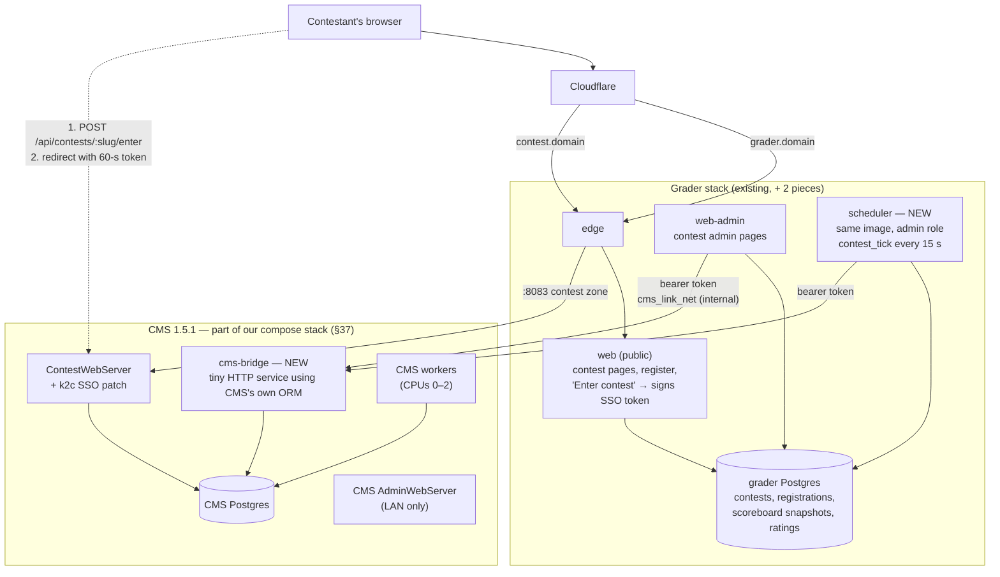

Rules:

- **The public `web` role never talks to CMS or the bridge.** Its only CMS-related job is signing a
  short-lived token with a private key (§25); CMS checks it with the public key. The public role
  gains no new network path.
- **Only `web-admin` and the new `scheduler` call the bridge**, over a new internal network
  `cms_link_net`, with a bearer token (same pattern as the worker token).
- **The bridge** runs from the same pinned CMS 1.5.1 source, so it uses CMS's own models and
  scoring code instead of hand-written SQL against CMS's schema.
- **`scheduler`** is a new service from the existing `grader-web` image in the admin role, running
  `manage.py contest_tick` in a loop. It replaces "someone must click a button at 15:30 sharp".

## 24. A contest's life

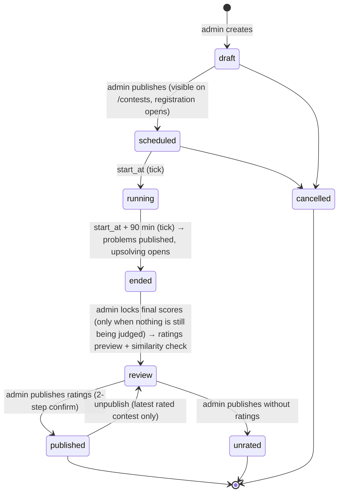

Contest day, minute by minute:

```mermaid
sequenceDiagram
    autonumber
    participant S as scheduler
    participant B as cms-bridge
    participant C as CMS
    participant U as Student
    participant W as web (public)

    Note over S,C: T−24 h and T−1 h: automatic pre-flight (§31) — red items alert the admin
    S->>B: sync participants (every tick, and instantly on NOTIFY for late joiners, until the end)
    B->>C: create/update User + Participation (random bcrypt password)
    U->>W: /contests/monthly-12 — countdown from server_time
    Note over U,W: T−15 min: "Enter contest" button appears
    U->>C: GET /monthly-12/k2c_start → state cookie, back to our site
    U->>W: POST /api/contests/monthly-12/enter {state}
    W-->>U: {url: contest.domain/monthly-12/k2c_sso?token=…} (token bound to the state, §25.3)
    U->>C: GET …/k2c_sso?token=… (patched CWS checks token + state cookie)
    C-->>U: Set-Cookie monthly-12_login → contest page (waits for start)
    loop every 15 s while running
        S->>B: GET scores
        B->>C: task_score() per participation × task
        S->>S: store ScoreboardSnapshot
    end
    U->>W: /contests/monthly-12/scoreboard (polls snapshot every 30 s)
    Note over S: T+90 min: tick → state ended, publish A/B/C into archive group "Monthly #12"
    S->>B: final scores + sources (bridge refuses sources before CMS stop)
    Note over S: admin: lock → review → publish ratings
```

## 25. Linking accounts and one-click sign-in

### 25.1 What CMS 1.5.1 does today (read from its source)

- Login is password (`allow_password_authentication`) or IP (`ip_autologin`); nothing else.
- After a password login it sets a Tornado **secure cookie** `<contest name>_login` holding
  `[username, stored password (hash), timestamp]`, signed with CMS's `secret_key`, valid for
  `cookie_duration` (default 3 h) and refreshed on each request.
- Every later request is authenticated from that cookie only
  (`cms/server/contest/authentication.py`).

So one-click sign-in = **a small extra handler inside CMS that sets exactly that cookie after
checking a token from us.** The rest of CMS is untouched and doesn't know the difference.

### 25.2 The account link

| Our side | CMS side |
|---|---|
| `CmsAccount(user, cms_username, cms_user_id)` | `User(username = k2c_<our username>, first_name = display name, password = bcrypt of 32 random bytes nobody keeps)` |
| `ContestRegistration(contest, user, synced_at)` | `Participation(contest, user, hidden = false)` |

- The `k2c_` prefix keeps our users apart from anyone else in the same CMS database (school or TOI
  practice contests). Confirm in §36.
- Passwords exist only because CMS requires one; they are random and never shown, so password
  login is effectively impossible. `allow_password_authentication` must stay **on**, because CMS
  reads the login cookie only when it is on (pre-flight checks it).
- Display-name changes are pushed to CMS on each sync until the contest starts.
- **Late joiners (allowed until the end):** registering inserts a `ContestRegistration` and runs
  Postgres `NOTIFY contest_registration`. The scheduler `LISTEN`s and syncs that one user to CMS
  at once (the public role still never calls the bridge). The contest page shows "Preparing your
  contest account…" and enables **Enter contest** as soon as `synced` is true — normally under 2 s.
  The 15 s tick is the fallback if a notification is missed.

### 25.3 The flow (rev. 6 — bound to the browser that started it)

Rev. 4 let our site hand out a token that *anyone* could open. Review S-1 showed the attack: a
contestant mints a token for **their own** account and sends a victim to the link; the victim's
browser is signed in to CMS as the attacker, the victim's submissions score for the attacker. Expiry
and single use don't help (the attacker mints a fresh one per victim). The fix is the same "state"
binding OAuth uses: the token only works in the browser that started the flow.

```mermaid
sequenceDiagram
    autonumber
    participant B as Student's browser
    participant C as contest.domain (CWS + patch)
    participant G as grader.domain (SPA + API)

    B->>C: GET /monthly-12/k2c_start  (top-level link from our contest page)
    C-->>B: Set-Cookie k2c_state=<random 128-bit> (HttpOnly, Secure, SameSite=Lax, 5 min, host-only)<br/>302 → grader.domain/contests/monthly-12/enter?state=<same value>
    B->>G: SPA page: "Enter Monthly #12 as kit_01?" [Enter]
    B->>G: POST /api/contests/monthly-12/enter {state}  (session + CSRF)
    G-->>B: {url: contest.domain/monthly-12/k2c_sso?token=…}  token holds sha256(state)
    B->>C: GET /monthly-12/k2c_sso?token=…  (SPA checks the origin = contest_origin first)
    C->>C: verify signature, aud, contest, exp, jti, sha256(k2c_state cookie) == token.state_hash
    C->>C: refuse if a valid login cookie for a DIFFERENT user is already present
    C-->>B: delete k2c_state, set <contest>_login (HttpOnly, Secure, SameSite=Lax) → contest page
```

Why this closes S-1: the attacker can get a token only for a `state` they know, i.e. one bound to
**their** browser's cookie. The victim's browser has a different `k2c_state` (or none), so the hash
doesn't match. A forged "start" link only leads the victim to sign in as **themselves**.

| Token field | Value |
|---|---|
| Format | JWT, **Ed25519** (`alg: EdDSA`, the only algorithm accepted), `kid` for key rotation |
| `aud` / `contest` | `"cms-sso"` / CMS contest name, must equal the contest in the URL |
| `sub` | CMS username (`k2c_kit_01`) |
| `state_hash` | SHA-256 of the `k2c_state` value |
| `exp` / `jti` | now + 60 s / 128-bit random, refused if seen in the last 2 min (per CWS process; lost on restart — acceptable now that the token is bound to one browser) |
| Keys | Private key only in `web/` secrets; CMS gets only the public key — a compromised CMS can't sign in as anyone |

`POST /api/contests/{slug}/enter` signs only when the user is signed in, registered, synced, not
excluded, and the contest is between start − 15 min and its end (plus any extra time). Rate-limited,
`no-store`. The SPA follows the returned URL only if its origin equals `contest_origin` from
`/api/site` (review F-8/S-13), in the same tab (`location.assign`, not `window.open` after an
`await`, which browsers block as a popup).

### 25.4 The CMS patch (sketch)

Kept in our backend repo as `deploy/cms/k2c-sso.patch` against the **pinned** CMS v1.5.1, with its
own tests; re-applied deliberately before any CMS upgrade.

```python
# cms/server/contest/handlers/k2c_sso.py  (sketch)
COOKIE_FLAGS = dict(httponly=True, secure=True, samesite="Lax")   # Tornado 4.5 sets none by default

class K2cStartHandler(ContestHandler):
    @multi_contest
    def get(self):
        state = secrets.token_urlsafe(16)
        self.set_cookie("k2c_state", state, expires_days=None, max_age=300, **COOKIE_FLAGS)
        self.redirect(config.k2c_enter_url.format(contest=self.contest.name, state=state))

class K2cSsoHandler(ContestHandler):
    @multi_contest
    def get(self):
        state = self.get_cookie("k2c_state")
        self.clear_cookie("k2c_state")
        claims = k2c_tokens.verify(self.get_argument("token", ""),
                                   public_keys=config.k2c_sso_public_keys, audience="cms-sso",
                                   contest=self.contest.name, now=self.timestamp,
                                   state=state, seen_jti=_SEEN_JTI)
        if claims is None or not self.contest.allow_password_authentication:
            return self.redirect(self.contest_url(login_error="true"))
        current = self.current_user            # participation from an existing login cookie, if any
        if current is not None and current.user.username != claims["sub"]:
            return self.redirect(self.contest_url(k2c_error="signed_in_as_other"))
        participation = (self.sql_session.query(Participation).join(Participation.user)
                         .filter(Participation.contest == self.contest)
                         .filter(User.username == claims["sub"]).first())
        if participation is None:
            return self.redirect(self.contest_url(login_error="true"))
        cookie = json.dumps([participation.user.username, get_password(participation),
                             make_timestamp(self.timestamp)]).encode("utf-8")
        self.set_secure_cookie(self.contest.name + "_login", cookie, expires_days=None, **COOKIE_FLAGS)
        self.redirect(self.contest_url())       # never a URL from the request
```

The patch also:
- adds the same `COOKIE_FLAGS` to CMS's own cookie **refresh** (`handlers/contest.py`, the
  `set_secure_cookie` call in `get_current_user`) and to `LoginHandler` (review S-5);
- starts CWS's WSGI server with an access logger that **drops query strings**, so tokens never reach
  Docker logs (review S-8; CMS 1.5.1 uses gevent's default logger, which writes full request lines).

### 25.5 Who CMS will let in (review S-6)

- Pre-flight requires `allow_registration = false` (otherwise anyone can self-register in CMS and
  appear in the scores), `ip_autologin = false`, `allow_password_authentication = true`.
- The bridge manages only users **it created**: it stores `cms_user_id` at creation and refuses to
  update or attach to an existing `k2c_*` user it doesn't know (e.g. one imported from the old CMS).

## 26. The bridge (`cms-bridge`)

A small HTTP service (≈ 300 lines) that imports CMS's own `cms.db` models and
`cms.grading.scoring.task_score`. It knows nothing about our database.

| Endpoint | Used by | Notes |
|---|---|---|
| `GET /health` | pre-flight | CMS DB reachable, version |
| `GET /contests/{name}` | pre-flight | start, stop, `per_user_time`, `allow_password_authentication`, `ip_autologin`, tasks (name, score mode, max score) |
| `PUT /contests/{name}/times` | admin "Sync times" button | our schedule → CMS `start`/`stop`. **CMS stores naive UTC** (`cmscommon/datetime.py`); the bridge converts, with a test — one missed conversion moves the contest by 7 hours (review O-13). Pre-flight compares epoch seconds |
| `PUT /contests/{name}/participants/{username}` | scheduler | idempotent create/update of User + Participation |
| `DELETE /contests/{name}/participants/{username}` | unregister | refused once the contest has started |
| `GET /contests/{name}/scores` | scheduler, every 15 s | per participation: **rounded** score per task, `partial` flag, `submitted` (≥ 1 submission), hidden flag, extra time; plus the contest's evaluation-queue length. One aggregate query over CMS's score tables rather than `task_score()` per participation × task, which is too slow on CPU 2 at the contest-end rush (review O-9) — verify it matches `task_score()` in a test |
| `GET /contests/{name}/sources` | similarity check | **refused before CMS `stop` + max extra time**; returns all submissions per task |
| `POST /contests/{name}/announcements` | admin | posts a CMS announcement from our admin page |

Auth: bearer tokens from secrets files, constant-time compare; listens only on `cms_link_net`.
It never accepts requests carrying an edge zone header (same rule as `/internal/*`). **Two tokens
with scopes (review S-10):** the scheduler's can sync participants, read scores and times; only
web-admin's can read sources, post announcements, change times or delete participants.

### 26.1 The scheduler, made safe (reviews O-9, B-9)

- **Two loops**, so a slow score fetch never delays a late joiner: `sync` (LISTEN/NOTIFY + 15 s
  fallback) and `scores` (15 s). Each tick takes a `pg_advisory_lock`; contest state changes take
  `SELECT … FOR UPDATE` on the contest row, so two scheduler copies or an admin "Extend" can't race.
- **Listener:** its own autocommit psycopg 3 connection (`LISTEN contest_registration`,
  `notifies(timeout=…)`), never Django's ORM connection; after any reconnect it LISTENs again and
  runs a full sync, because notifications sent while disconnected are lost. NOTIFY from the web
  request is safe: Postgres delivers it on commit.
- **Heartbeat row** every tick; pre-flight and the external alert fire if it's older than 60 s —
  if the scheduler dies, nothing publishes at the end and nobody would notice.
- **Own role, own secrets:** a `scheduler` role (not "admin") so it doesn't need the worker token or
  the admin URLconf; today `settings.py` fails to start an admin-role process without the worker
  token.

## 27. Public live scoreboard

- `scheduler` stores a `ScoreboardSnapshot` (JSON: rows, `taken_at`) every 15 s while running, and
  a final one at the end.
- `GET /api/contests/{slug}/scoreboard` reads the latest snapshot: one query, no CMS call, so a
  crowd refreshing the scoreboard can't touch CMS. `Cache-Control: public, max-age=10`.
- The page polls every 30 s (pausing in hidden tabs) and shows "updated 12 s ago" from `taken_at`.
- Columns: rank (shared on equal totals), name coloured by the **pre-contest** rating, A / B / C
  (points, with full-score highlight), total. CMS-hidden participations are left out.
- **Final standings wait for judging (review R-1).** At the end the scoreboard says "Judging the
  last submissions…"; the scheduler takes the `final` snapshot only when the bridge reports no
  `partial` score and CMS's evaluation queue for the contest is empty. "Lock" in the admin review
  page refuses until then, and also while any submission ended in a system/judge error that hasn't
  been rejudged.
- After the contest, the final snapshot stays as the contest's standings; after rating
  publication, rows add old → new rating and the delta.

## 28. Rating (Codeforces-style)

Based on Codeforces' published rating algorithm (Mike Mirzayanov, 2015). Implemented as a pure
function `ratings.calculate(contestants) → deltas` in `common/` or `judging/`, with no database
access, so it is unit-tested with fixed inputs.

```
input: contestants who submitted ≥ 1 time and are not excluded,
       each with INTERNAL rating r (new users: 1400, see 28.0) and total points

1. rank: sort by ROUNDED points desc (task_score(..., rounded=True)); a group with equal
   points gets the AVERAGE of its places (rev. 6 — see note below).
2. P(j beats i) = 1 / (1 + 10^((r_i − r_j) / 400))
3. seed_i = 1 + Σ_{j≠i} P(j beats i)              (expected place)
4. m_i   = sqrt(seed_i × rank_i)                   (geometric mean of expected and actual)
5. R_i   = the rating that would give seed = m_i   (binary search)
6. d_i   = (R_i − r_i) / 2
7. shift all d by  −(Σd)/n − 1                     (total change ≤ 0, stops inflation)
8. top s = min(n, 4·round(√n)) by rating: shift all d by
   min(max(−Σ_top d / s, −10), 0)                  (top group's changes sum to ≈ 0)
```

- **Ties (rev. 6, review R-2):** Codeforces gives a tied group its *last* place. That works on
  Codeforces, where penalty time makes big ties rare. With IOI scores and 3 problems, groups of
  15–40 people on one total (everyone on 100, everyone on 0) will be normal here, and "last place"
  pushes all of them down together. We use the **average place** for rating. The scoreboard still
  shows the shared *best* place (what people expect to see); `ContestResult` stores both
  (`display_rank`, `rating_rank`). This is the one deliberate deviation from Codeforces — say so on
  the rating rules page.
- **Arithmetic:** integers, truncating toward zero, exactly as Codeforces' published reference code
  (needed for "recompute all must match exactly"). The two reviewers read the reference differently
  on whether a contestant's own term is in the step-5 search; **port Mirzayanov's 2015 reference
  code line by line** and pin it with test vectors produced by that code, rather than either reading.
- **Partial scores (review R-1):** CMS's `task_score()` returns `(score, partial)`; `partial` means
  a submission isn't scored yet. The bridge returns the flag, and the final snapshot, "lock" and
  ratings wait until nothing is partial and CMS's evaluation queue for the contest is empty.
- Tests: the paper examples, symmetry (identical players ⇒ equal deltas), monotonicity (better rank
  never gives a smaller delta than a worse rank for the same rating), and a comparison against an
  independent open-source Codeforces-rating implementation on random contests.
- **Excluded** contestants are removed before step 1 (everyone below moves up) and get no change.
- **History is the truth:** `RatingChange` rows per contest are stored; a user's rating is the last
  one. "Recompute all" replays every published contest in order and must reproduce the stored
  values exactly (a test and an admin button).
- Only the **latest** published contest can be unpublished; older fixes go through "recompute all".
- **Monthly ratings swing (R-14).** With 12 contests a year, small fields and the "/2" damping,
  a rating moves a lot from one month to the next. That is expected; say so on the rating rules page.

### 28.2 When something goes wrong (written policy, review R-7)

| Situation | What we do |
|---|---|
| A subtask's tests or checker are wrong, found **during** the contest | Fix in CMS, rejudge that task, post a CMS announcement; extend the contest if the fix took long |
| Same, found **after** the end but **before** lock | Rejudge in CMS; the final snapshot waits for it; then lock |
| A whole problem is broken | Remove it from scoring (rescore the other two) **or** publish the contest unrated; announce which, with the reason, on the contest page |
| Judge or site outage for some people | Per-person extra time (§31); if many people were hit, publish unrated |
| Problem found broken **after** ratings were published | Latest contest: unpublish → fix → publish again. Older contest: fix its results, then "recompute all" (shows the diff before saving) |
| Contest compromised (leak, mass cheating) | Publish unrated; exclusions stay recorded |

### 28.0 Starting at 0 (your answer) — how, without breaking the maths

Elo-style ratings only care about **differences**, so the starting number itself doesn't matter for
fairness. Two problems appear if the calculation literally starts everyone at 0:

- about half the players end up **negative** (they're below the starting point), which looks bad
  and breaks rank thresholds;
- step 7 above makes the average drift slowly down, so negatives grow over time.

Codeforces solved exactly this in 2020 by separating the number you **see** from the number the
maths **uses** (as I understand their announcement; check it before coding):

| | New account | After each of the first 6 rated contests | After that |
|---|---|---|---|
| Internal rating (used in the formula) | 1400 | normal change | normal change |
| Displayed rating | **0** | internal − 1400 + bonuses so far; bonuses **+500, +350, +250, +150, +100, +50** (sum 1400) | = internal |

So everyone starts at 0 on screen, climbs quickly for their first 6 contests (motivating), and
after 6 contests the displayed and internal ratings are the same. The formula never sees a 0.
`RatingChange` stores both internal and displayed values; ranks and colours use the **displayed**
one. If you'd rather keep it literally simple (internal = displayed, start 0, negatives allowed),
it's one constant — but I recommend the scheme above.

### 28.1 Ranks and colours — your own names, editable without code

Rank names and thresholds are **data**, not code: a `RankTier` table (`min_displayed_rating`,
`key`, `name_th`, `name_en`, `colour_slot`) edited on an admin page, with a live preview of how
many current users fall in each tier. You can launch with placeholders and rename later; history
isn't affected because only ratings are stored, never rank names.

`colour_slot` is one of ~10 fixed colours defined in the frontend CSS (`.rank-slot-3`, never per
key, since keys are admin data). Fixed slots keep contrast checked in both themes. (Rev. 5 said the
CSP blocks inline styles from data; that was wrong — React sets `style` through the CSSOM, which
`style-src 'self'` allows. Slots are still the right choice, for contrast.) The API embeds
`rank: {key, name, colour_slot}` in every user object, so a newly added tier needs no frontend change.

**Choosing thresholds (review R-10).** Codeforces' thresholds are tuned for tens of thousands of
players. With 20–100 people the spread of ratings is much narrower, so the top tiers would likely
never be reached, and the new-account bonuses keep newcomers in the lowest tier for months. Before
the first rated contest, run the rating engine on simulated seasons (12–24 contests at your real
participant count, from the dry run) and set thresholds so each tier is actually reachable; the
tier-editor preview then shows the real spread as contests happen.

Placeholder tiers until you decide (Codeforces' thresholds, shown only as an example):

| Rank key | Rating | Colour |
|---|---|---|
| `unrated` | no rated contest yet | default text |
| `newbie` | < 1200 | gray |
| `pupil` | 1200–1399 | green |
| `specialist` | 1400–1599 | cyan |
| `expert` | 1600–1899 | blue |
| `candidate_master` | 1900–2099 | violet |
| `master` | 2100–2299 | orange |
| `international_master` | 2300–2399 | orange |
| `grandmaster` | 2400–2599 | red |
| `international_grandmaster` | 2600–2999 | red |
| `legendary_grandmaster` | ≥ 3000 | red (first letter black) |

Colours live in the frontend's CSS (classes per key) so the API only sends the key. Colour is never
the only signal: the rank name is in the tooltip and on the profile.

## 29. Similarity check

- **What it can't catch (review R-3):** AI-written solutions are the main cheating risk for an
  unsupervised online contest in 2026, and A/B are trivial for an LLM. No code-similarity tool
  detects that. State the rule in the contest rules, accept the limit, and optionally review by hand
  anyone who finishes far above their rating. Don't present the similarity check as "the anti-cheat".
- Runs when the admin locks final scores (state `review`), on **all** submissions per user per
  problem (not only the last scored one, which misses copies submitted earlier), fetched via the bridge.
- Tool: a self-hosted winnowing/fingerprint checker (e.g. the `copydetect` Python package, which
  handles C, C++ and Python), run as a background job in web-admin. Nothing is sent to an outside
  service (students' code stays on the NAS — PDPA).
- Output: pairs above a threshold, with a side-by-side view in the admin page. **It only flags.**
  A human decides; each exclusion needs a reason and is audit-logged.
- Short "A"-level solutions are naturally similar, and shared templates (`bits/stdc++.h`, fast-I/O
  macros) inflate every score: pass a boilerplate corpus to the checker, sort the review page by
  problem C first, and **never exclude on A alone** unless the code is near-identical and submitted
  minutes apart (review R-4).

## 30. Problems after the contest and upsolving

- Before the contest, the admin imports the same three task zips into **our** grader as **hidden**
  problems (the importer already reads CMS Italian format) and validation runs as usual. Contest
  setup maps A/B/C → our hidden problem + CMS task name.
- The scheduler publishes them into the archive group "Monthly Contests → Monthly #12" at CMS
  `stop` **plus the largest per-person extra time** (review R-6), never earlier.
  From then on they are normal practice problems: **this is the upsolving**, unrated by design.
- Pre-flight refuses to schedule a contest whose problems are visible or failed validation, so
  nothing leaks early (hidden problems are already 404 everywhere on the public site).
- Practice scores on these problems never affect rating.

**Problem testing before a contest (review R-12).** Pre-flight shows a checklist per problem that
must be ticked by name: tested by at least **two people** who didn't write it · a model solution per
subtask scores exactly that subtask · known wrong solutions (wrong algorithm, too slow, off by one)
fail as expected · limits calibrated (the grader's existing Calibrate page) · statement PDF in both
languages, samples match the tests. Setters and testers are registered **unrated and hidden**
(`ContestRegistration.rated = false`, CMS `hidden = true`) so they can watch the contest from inside
without appearing on the scoreboard or affecting ratings.

## 31. Admin pages (admin site, same style as the existing Grader pages)

| Page | What it does |
|---|---|
| **Contests** | List with state, start (Bangkok time), registrations, last pre-flight result, quick links |
| **Contest — setup** | Title, slug, start, duration (default 90 min), rated yes/no, registration open until the end (default), CMS contest name, A/B/C mapping (our problem + CMS task), announcement text, publish / cancel |
| **Contest — pre-flight** | Green/red checklist, also run automatically at T−24 h and T−1 h: bridge healthy · scheduler heartbeat fresh · CMS contest exists · CMS times = ours (epoch compare) · `allow_password_authentication` on, `ip_autologin` off, **`allow_registration` off** · tasks match mapping · **scoring settings: score mode max-per-subtask, tokens off/infinite, full feedback, languages, submission limits** (review R-8) · our problems hidden and validated · all registrants synced · testers/setters marked unrated · SSO test (admin signs in to CMS through the real flow as a hidden test account) · practice pause window created · **deploy freeze on** (no image updates from T−24 h to the end, review O-12) |
| **Contest — live** | Registrations and sync status, scoreboard snapshot age, CMS evaluation queue, "send CMS announcement", "extend contest" (moves both our end and CMS `stop`), **per-person extra time** (CMS `Participation.extra_time`, for someone hit by an outage, review R-6), mark a registration unrated |
| **Contest — review** | Final standings, similarity pairs with side-by-side code, exclude (reason required), **rating preview** (rank, old, seed, performance, delta, new — **admin-only**, never public during or before publication, review R-13), publish ratings (type the contest slug to confirm) or publish unrated |
| **Ratings** | Rating table, per-user history, "recompute all" with a diff before saving |

All actions use the existing audit log and model permissions (a helper can run the live page
without being able to publish ratings).

### 31.1 Contest-day runbook (review R-11)

Kept as `docs/CONTEST-RUNBOOK.md` and walked through in the dry run.

| When | What | Who |
|---|---|---|
| T−7 d | Problems imported in both systems, tested (§30 checklist), contest published, registration open | setter + owner |
| T−24 h | Automatic pre-flight; fix every red item. **Deploy freeze starts** | owner |
| T−1 h | Automatic pre-flight again; owner signs in to CMS through the real SSO flow as a hidden test user | owner |
| T−15 min | **Go / no-go.** No-go ⇒ postpone with an announcement on the contest page | owner |
| T+0 … T+90 | One person on duty at the CMS admin (`:8084`, LAN or Access): answers CMS questions, watches the evaluation queue and the scheduler heartbeat on the live page | on-duty admin |
| During | **SSO broken:** admin sets a CMS password for the affected user on the CMS admin page and sends it privately. **Judge stalled:** check CMS worker containers; restart one at a time; extend the contest if the queue was blocked > 5 min. **Site down:** CMS keeps working on its own hostname; announce there | on-duty admin |
| T+90 | Wait for "judging finished" on the live page → lock → review similarity pairs → preview → publish (or publish unrated) | owner |
| T+1 d | Deploy freeze ends; write down what went wrong for the next runbook version | owner |

Announcement templates (Thai and English) for: start delayed, problem fixed + rejudged, contest
extended, contest unrated.

## 32. Public pages and API additions

| Frontend route | API |
|---|---|
| `/contests` | `GET /api/contests` → upcoming / running / past, with `server_time` for countdowns |
| `/contests/:slug` | `GET /api/contests/{slug}`; `POST` / `DELETE /api/contests/{slug}/registration`; `POST /api/contests/{slug}/enter` |
| `/contests/:slug/scoreboard` | `GET /api/contests/{slug}/scoreboard` (live, then final) |
| `/contests/:slug/results` | `GET /api/contests/{slug}/results` (after publication: rank, points, old/new rating, delta) |
| `/rating` | `GET /api/rating?page=` (rated leaderboard; the practice `/ranking` stays) |
| `/users/:username` | profile adds `rating {current, max, contests}` and `rank {key, name, colour_slot}`; `GET /api/users/{username}/rating-history` for the graph |

Contract changes:
- **Additive, not breaking (rev. 6, review D-3):** v1's profile `title` (solved-count) stays as the
  contract defines it. v2 **adds** `rating {current, max, contests}` and `rank {key, name,
  colour_slot}`; the frontend switches what it *shows* to the rating rank when v2 ships (your
  decision), and `title` is dropped only in a later contract version.
- Every embedded `user` object (submission rows, ranking rows, scoreboard rows) gains
  `rank {key, name, colour_slot}`, so names can be coloured anywhere. Serializers join it in the same
  query (fixed query count).
- Contest JSON shapes must be written into the contract **before** F6 starts (review F-7): `end_at`,
  `enter_opens_at`, `registered`, `synced`, `can_enter`, `rated`, `server_time` on list *and* detail,
  per-problem letter and max points, scoreboard `taken_at` and the viewer's own row, results rows.
- `/api/site` gains `contest_origin` (the only off-site origin the SPA may navigate to).
- Countdowns use `server_time` from the API, never the device clock.
- The rating graph is drawn as plain SVG in React (no chart library that injects styles — F-22).

## 33. Data model additions

```mermaid
erDiagram
    CONTEST ||--o{ CONTEST_PROBLEM : "A, B, C"
    PROBLEM ||--o| CONTEST_PROBLEM : "used as"
    CONTEST ||--o{ CONTEST_REGISTRATION : "has"
    USER ||--o{ CONTEST_REGISTRATION : "registers"
    USER ||--o| CMS_ACCOUNT : "linked to"
    CONTEST ||--o{ SCOREBOARD_SNAPSHOT : "every 15 s"
    CONTEST ||--o{ CONTEST_RESULT : "final"
    CONTEST ||--o{ RATING_CHANGE : "published"
    USER ||--o{ RATING_CHANGE : "history"
    CONTEST ||--o{ SIMILARITY_PAIR : "flags"

    CONTEST {
        string slug
        string title
        string cms_contest_name
        datetime start_at
        int duration_minutes
        string state
        bool rated
    }
    CONTEST_PROBLEM {
        string letter
        string cms_task_name
    }
    CONTEST_REGISTRATION {
        bool rated "false for testers and setters"
        datetime registered_at
        datetime synced_at
    }
    CMS_ACCOUNT {
        string cms_username
        int cms_user_id
    }
    SCOREBOARD_SNAPSHOT {
        datetime taken_at
        json rows
        bool final
    }
    CONTEST_RESULT {
        int display_rank
        float rating_rank
        float points
        json per_problem
        bool submitted
        bool excluded
        string excluded_reason
    }
    RATING_CHANGE {
        int old_internal
        int new_internal
        int old_displayed
        int new_displayed
        int delta
        float rating_rank
        float seed
        int performance
    }
    SIMILARITY_PAIR {
        string letter
        float score
        string decision
    }
```

`User` gains cached `rating`, `max_rating`, `rated_contests` (rebuilt from `RatingChange` by
"recompute all"). Snapshots older than the final one are pruned a week after the contest.
Constraints: unique `(contest, user)` on `ContestRegistration`, `ContestResult` and `RatingChange`.

## 34. Security review of the contest feature

| ID | Sev | Risk | Control |
|---|:---:|---|---|
| C-01 | H | SSO token leak or replay (it travels in a URL and can land in CMS/Cloudflare logs) | 60 s expiry, single-use `jti`, `aud` + contest bound, Ed25519 with pinned algorithm, CMS holds only the public key, `kid` rotation; CWS redirects immediately so the token isn't left in the address bar |
| C-02 | H | Problems leak before the contest | Hidden until the scheduler publishes them at `end`; pre-flight blocks visible problems; bridge refuses sources before CMS `stop` |
| C-03 | H | The public site becomes a path into CMS | Public role has no route to CMS or the bridge; only web-admin/scheduler on `cms_link_net`; bridge token + no edge zone header |
| C-04 | M | `contest.domain` (CMS, an older Tornado app) is a same-site sibling of the practice site | Our strict CSRF on every unsafe request (F-01) and `Origin` checks; cookies host-only on both sides; never CORS. CMS AdminWebServer stays LAN-only |
| C-05 | M | Multiple accounts to farm or protect rating | One Google identity per account (already enforced); similarity review; exclusion with audit; rating preview before publishing |
| C-06 | M | Wrong ratings published | Pure, tested calculation; preview; two-step publish; only the latest contest can be unpublished; deterministic "recompute all" |
| C-07 | M | CMS and our site disagree on times | Pre-flight compares; "Sync times" writes ours into CMS; "Extend contest" changes both |
| C-08 | M | Scoreboard load reaches CMS | Snapshots every 15 s; public reads never call CMS |
| C-09 | L | Display names rendered by CMS | Names already block control and format characters (`Cc`, `Cf`); CMS templates autoescape |
| C-10 | M | The CMS patch drifts | Pinned v1.5.1, patch + tests in our repo, re-applied deliberately |
| C-11 | M | PDPA: CMS also stores names and code | §19's deletion procedure includes a bridge call to anonymise the CMS user |
| C-12 | M | Same NAS on contest day: CMS judging + our practice judging + crowd | Separate CPUs and memory budget (§37.4); publishing a contest **automatically creates a practice pause window** from start to end + 10 min (existing `PauseWindow`; the site shows the existing "grading paused" banner; practice submissions queue and are judged afterwards) |
| C-13 | H | CMS workers have DB credentials | Separate `cms-db`; worker hardening as ours; no internet |
| C-14 | M | CMS contest pages need inline scripts | CSP relaxed only on `:8083`; practice origin keeps the strict CSP and `__Host-` cookies (F-20) |
| C-15 | M | CMS admin exposed | `:8084` LAN or Access only, bound to that address; never on the public hostname |
| C-16 | M | CMS's upstream image habits (`sudo`, many toolchains) | Own minimal image, non-root services (workers root inside their container only), pinned commit + digest |
| C-17 | L | CMS RPC ports reachable from elsewhere | `cms_net` internal; nothing else joins it |
| C-18 | M | **Late joiners are rated (accepted, decided 2026-10-29).** Someone joining at minute 70 has seen the live scoreboard and knows which problems are easy; someone can also open CMS, read the problems and stay unrated by not submitting | Accepted for a small community. Watch it: the review page marks late registrations; if it's abused, a cut-off is one setting (`rated = false` after N minutes) — no redesign needed |
| C-19 | M | AI-written solutions | Can't be detected by code similarity; stated in the contest rules; optional manual review of unusual jumps (§29) |
| C-20 | L | CMS 1.5.1's end-of-life libraries face the internet | Accepted with mitigations (§37.5): Cloudflare WAF + rate rule on `contest.domain`, network split, nothing but contest data in `cms-db` |

## 35. Milestones (after the practice site launches)

> **Superseded by §42 (rev. 6)** for dates and order; the task content still applies.

```mermaid
gantt
    dateFormat  YYYY-MM-DD
    axisFormat  %d %b
    title Contest & rating milestones (estimates)

    section Backend
    M6 Contest models, admin setup, scheduler, public list + countdown + registration :c6, 2027-01-04, 10d
    M7 cms-bridge, CMS SSO patch, Enter contest, pre-flight                        :c7, after c6, 10d
    M8 Live scoreboard, end-of-contest publish, upsolving, results                 :c8, after c7, 7d
    M9 Rating engine + tests, review page, similarity, publish, recompute         :c9, after c8, 10d

    section Frontend
    F6 /contests, contest page, countdown, register                               :g6, 2027-01-04, 7d
    F7 Enter contest, live scoreboard                                             :g7, after g6, 7d
    F8 Results, rating page, profile graph, rank colours everywhere               :g8, after g7, 10d

    section Run
    Unrated dry run with friends                                                  :milestone, d1, after c8, 0d
    First rated monthly contest                                                   :milestone, d2, after c9, 0d
```

Run **one unrated dry-run contest** end to end (register → enter → scoreboard → archive) before the
first rated one. Ratings then start from a clean, tested pipeline.

## 36. Still to confirm

**Answered** — 2026-10-28: same start for everyone · start at 0 (§28.0) · own rank names, later
(§28.1) · late joiners allowed · CMS inside the stack · practice paused during contests ·
`k2c_<username>`. 2026-10-29: average place for ties (§28) · late joiners **rated normally**, no
cut-off (C-18) · NAS RAM stays 8 GB; no upgrade — v1 on the NAS, full stack on the laptop later (§43, rev. 9) · CMS
moves **into the stack from the first contest**, no interim period on the old install (§42).

**Open:**

1. **Day and time** of the monthly contest (only a default in the setup form; any time works).
2. **Rank names and thresholds** — after a simulated season (§28.1); it's an admin page, no deploy.
3. **The CMS already on the NAS:** anything in it to keep (old contests, users)? If yes, it's
   exported with CMS's own tools and imported into the in-stack CMS (§37.6); if no, it's switched off.
4. **Kernel version of the NAS** — needed while contests run on the NAS (Phase A): CMS's isolate
   needs ≥ 5.19 for memory reporting (ZimaOS → Settings → About). The laptop's Ubuntu 24.04 answers
   it after the move; its cores are known (8 / 16 — confirm the model with `lscpu`).
5. **When to move to the laptop** — no date needed now; §43 lists what should trigger it.
6. **After the move:** does the laptop's Linux expose the battery charge limit? (§44 — check that
   `charge_control_end_threshold` exists.)

## 37. CMS inside our stack

CMS 1.5.1 becomes part of the same Docker Compose app, built and pinned like every other image.
The CMS install the prototype ran *next to* is retired (§37.6).

### 37.1 What CMS is made of (from the 1.5.1 source)

CMS isn't one program: `cms.conf` lists `LogService`, `ResourceService`, `ScoringService`,
`Checker`, `EvaluationService`, `Worker`(s), `ContestWebServer`, `AdminWebServer`, `ProxyService`
(feeds CMS's own ranking server) and `PrintingService`. They talk to each other over RPC ports and
**all of them, workers included, read the CMS database directly** (files are stored in it).

In Docker we run each needed service as its own container from **one image** (like the grader's
two web roles), and skip what we don't need:

| Service | Run? | Why |
|---|---|---|
| LogService, ScoringService, Checker, EvaluationService | yes | core judging pipeline |
| Worker × 2 | yes | judging in isolate (CMS 1.5 needs cgroup v2 isolate, vendored as a git submodule) |
| ContestWebServer | yes | the contest UI students use |
| AdminWebServer | yes, **LAN/Access only** | creating contests and tasks |
| ResourceService | no | it starts/restarts services; Docker does that |
| ProxyService + RankingWebServer | no | our own public scoreboard replaces it (§27) |
| PrintingService | no | online contest |
| **cms-bridge** | yes | our service (§26), same image, different command |

### 37.2 Image: `grader-cms`

- Built in the backend repo from **CMS v1.5.1 pinned by commit** + its isolate submodule + our
  `k2c-sso.patch` + the bridge. Released with the other images, pinned by digest.
- **Not** based on CMS's own `Dockerfile`: that one is a dev/test image (passwordless `sudo`, every
  language toolchain). Ours: only the compilers the contests use (C, C++, Python — same as the
  practice judge, so a solution behaves the same in both), no `sudo`, non-root for every service
  except the workers.
- `cms.conf` is generated at container start from environment + secrets files (DB URL, `secret_key`,
  SSO public key), never baked into the image.

### 37.3 Services and networks

```mermaid
flowchart TB
    subgraph EDGE["edge (Caddy)"]
        P80[":8080 public site"]
        P83[":8083 contest zone — NEW<br/>(contest.domain via tunnel)"]
        P84[":8084 CMS admin — NEW<br/>LAN, or tunnel + Cloudflare Access"]
    end
    subgraph CMSNET["cms_net (internal) — CMS RPC"]
        LOG["cms-log"]
        SCO["cms-scoring"]
        CHK["cms-checker"]
        EVA["cms-evaluation"]
        WK1["cms-worker-1"]
        WK2["cms-worker-2"]
        CWS["cms-contest (CWS + k2c SSO)"]
        AWS["cms-admin (AWS)"]
    end
    CDB[("cms-db<br/>separate Postgres")]
    BR["cms-bridge"]
    WA["web-admin"]
    SCH["scheduler"]
    BK["backup"]

    P83 --> CWS
    P84 --> AWS
    LOG & SCO & CHK & EVA & WK1 & WK2 & CWS & AWS -- "cms_db_net" --> CDB
    BR -- "cms_db_net" --> CDB
    WA & SCH -- "cms_link_net" --> BR
    BK -- "cms_db_net" --> CDB
```

| Network | Members | Internet |
|---|---|---|
| `cms_net` | all CMS services (RPC between them) | no |
| `cms_db_net` | `cms-db`, CMS services, `cms-bridge`, `backup` | no |
| `cms_link_net` | `cms-bridge`, `web-admin`, `scheduler` | no |
| `cms_contest_edge_net` | `edge`, `cms-contest` | no |
| `cms_admin_edge_net` | `edge`, `cms-admin` | no |

Two edge networks, not one (review S-3): with a shared network, a compromised `cms-contest` (an
internet-facing app on an end-of-life Tornado 4.5 / Jinja2 2.10 stack) could reach `cms-admin`
directly. And because Caddy binds `:8081`/`:8084` on all interfaces today, each admin listener gets
a `bind` to its LAN/tunnel address only, so nothing on a CMS network can reach the grader admin.

Decisions and why:

- **A separate Postgres (`cms-db`) for CMS**, not a second database in ours. CMS workers must have
  database credentials (CMS's design: they fetch files from the DB). Our own worker was built to
  have *no* database access; putting CMS in our Postgres would undo that. With a separate server, a
  compromised CMS worker reaches CMS data only, never practice users, sessions or ratings.
- **The grader's networks don't change.** No CMS container joins `app_net`, `db_net` or
  `judge_net`; only `web-admin` and `scheduler` gain `cms_link_net`.
- **CMS workers get the same hardening as our worker:** own cgroup namespace, all capabilities
  dropped except the ones isolate needs, no internet, a process limit, and a memory cap with no swap
  (`memswap_limit` = `mem_limit`; CMS's docs also warn that swap breaks memory limits).
- **…and the same cgroup set-up, or isolate won't run (review O-5).** CMS's sample `isolate.conf`
  uses `cg_root=/sys/fs/cgroup`; inside a private cgroup namespace that root holds the Worker's own
  processes, and cgroup v2 refuses controllers for box cgroups under it; the tree is also mounted
  read-only. Port `grader_worker.setup` (move own processes into a leaf, remount read-write, enable
  `cpuset`/`memory`/`pids`) into a CMS-worker entrypoint with `cg_root=/sys/fs/cgroup/cms-judge`.
  Run the CMS Worker as root inside its container and do **not** install isolate setuid (CMS normally
  runs a setuid isolate as `cmsuser`; `no-new-privileges` would break that). Run isolate's self-check
  on the NAS in M6b. CMS 1.5.1 pins isolate **2.0**; memory reporting needs kernel ≥ 5.19 — record
  the ZimaOS kernel version.
- One container per worker, each with its own shard number; `cms.conf` lists them as
  `["cms-worker-1", 26000]`, `["cms-worker-2", 26000]`.

### 37.4 CPUs and memory (CPU table superseded by §44 — the stack now runs on the laptop)

| CPUs | Normal days | Contest (practice paused) |
|---|---|---|
| 0–1 | CMS workers' sandboxes (idle) | **CMS judging** |
| 2 | CMS services + `cms-db` | CMS services + `cms-db` |
| 3 | grader services (db, web, web-admin, edge, scheduler, ops) | same + scoreboard/contest page traffic |
| 4–5 | practice judging | idle (paused) |

Later option: a "contest mode" compose profile that also gives CPUs 4–5 to two extra CMS workers
while practice is paused. Not in v1: two isolate setups sharing CPUs needs care, and 2 workers for
3 problems × 90 min is likely enough. Measure in the dry run.

**Memory: is 8 GB enough for ~30 contestants?** The number of people barely matters. 30 browsers
are a few requests a second, and judging memory depends on how many submissions run **at the same
time** (one per worker box), not on how many people are registered. What uses memory is the number
of services. Every container gets a hard `mem_limit` with swap off (`memswap_limit` = `mem_limit`),
so the budget is the sum of the limits:

| Group | Containers (limits from the prototype's ZimaOS compose; CMS ones proposed) | Limit |
|---|---|---:|
| Grader (today) | db 512m · web 384m · web-admin 384m · worker 1408m (1 GB of it is sandboxes) · edge 96m → **192m** (O-7) · tunnel/ops/init 64–192m | ≈ 3.3 GB |
| New in v2 (grader side) | scheduler | 0.25 GB |
| CMS services | cms-db 512m · log 128m · scoring 192m · checker 128m · evaluation 256m · contest (CWS) 384m · admin (AWS) 384m · bridge 192m · cms-backup 128m | ≈ 2.3 GB |
| CMS workers | 2 × (worker process 256m + one box at the contest limit, 256 MB, plus compiler headroom 256m) | ≈ 1.5 GB |
| ZimaOS + Docker + file cache | not limited; Postgres relies on the file cache for speed | ≈ 1–1.5 GB |
| **Total** | | **≈ 8.4–8.9 GB** |

So **8 GB is over-committed.** It would probably *run* — limits are ceilings and most containers use
well under theirs — but with swap off, the moment several hit their peak together (contest end:
last-minute submissions compiling in CMS while the scoreboard and the crowd are busy), the kernel's
OOM killer stops a container, possibly `cms-db` or a worker, in the middle of the contest.

**What this means (rev. 9):** v1, the practice site only (≈ 3.5 GB of limits), is fine on the
NAS's 8 GB. The full v2 stack wants a 16 GB machine — that's the laptop (§43), whenever you move.
No RAM purchase is planned.

**8 GB contest mode** — for any contest that runs **before** the move: run **one** CMS worker
(−0.75 GB; 30 people × 3 problems is light), stop the grader's practice worker container during the
contest (practice is paused anyway, −1.4 GB), and keep the other limits as above. That brings the
total to about 6.5 GB, which fits with some room. It's a compose profile (`--profile contest-8gb`),
switched on by the contest-day runbook (§31.1). Re-measure memory peaks in the dry run with
`docker stats`; if the dry run comes close to 8 GB, move to the laptop before the first rated
contest.

### 37.5 Edge, CSP and secrets

- `:8083` (contest zone, `X-Edge-Zone: contest`) proxies to `cms-contest`. CMS's pages use
  **inline `<script>`**, which our strict CSP forbids, so this port gets its own CSP allowing
  `'unsafe-inline'` scripts **for the contest host only**. The practice site keeps the strict one.
  The contest host is a different origin, so this weaker CSP can't affect the practice site's pages
  (CSRF across the sibling is covered by C-04).
- `:8084` proxies to `cms-admin`: LAN only, or through the tunnel with Cloudflare Access (same model
  as today's remote admin `:8082`). Never on the public hostname.
- Body limits: `:8083` capped at CMS's own submission limit plus margin; `:8084` larger for task
  uploads (like the grader's import pages).
- `secrets-init` adds: `cms-db/` password, `cms/` (DB URL password, `secret_key` for CMS cookies),
  `cms-bridge/` token, and the **SSO key pair** (private half only in `web/`, public half only in
  `cms/`).
- **Backups (review O-10):** a separate `cms-backup` container (so `backup` doesn't sit on both DB
  networks). CMS keeps test data inside its database, so dumps are big: keep fewer copies, alert on
  backup age and free disk, and copy backups off the NAS. A scripted **restore drill** for both
  databases each quarter. The two databases are restored independently, so the link between them is
  re-made by `cms_username`, never by `cms_user_id`.
- `prod-smoke.sh` gains checks for the new networks and ports (`cms-worker` can't reach the grader
  DB or the internet; `:8080` can't reach `cms-*`; `cms-contest` can't reach `cms-admin` or edge `:8081`).
- **Accepted risk (review S-4):** CMS 1.5.1 pins end-of-life libraries (`tornado==4.5.3`,
  `Jinja2<2.11`, `werkzeug<1.0`). Mitigations: Cloudflare WAF and a rate rule on `contest.domain`,
  the network split above, and nothing valuable in `cms-db` beyond contest data.

### 37.6 Moving off the existing CMS install

1. If anything in the old CMS must be kept (§36 #3): export it with CMS's dump exporter and import
   it into `cms-db` with the importer of the **same** CMS version.
2. Stop the old CMS services; its isolate setup (cgroup root, box ids 0–…) is no longer used. Our
   worker's separate isolate namespace (box ids 100–109) stays as it is.
3. Point `contest.domain` in the Cloudflare tunnel at edge `:8083`.

### 37.7 Milestone change

Insert **M6b — CMS in the stack** between M6 and M7: the image, services, networks, edge ports,
secrets, backups, smoke tests, and one manually created test contest judged end to end. The bridge
and SSO (M7) build on it. Its risks (C-13 to C-17) are in §34 with the rest of the contest risks.

---

# Part 5 — Six-reviewer audit (rev. 6, 2026-10-29)

Six independent reviewers read rev. 5 against the real code (prototype, website repo, CMS 1.5.1),
DRF/Django/Caddy/Axios/Codeforces sources, and — for the edge — by running the Caddyfile on Caddy
2.11 against stub backends. Each had one angle. Their findings are merged here; fixes were applied
in place in the sections listed.

## 38. Scores

| Reviewer | Rev. 5 | Biggest catch |
|---|:---:|---|
| Security | 5.5 | SSO token not bound to the browser → **account swap** (S-1); sibling subdomain can **plant a session cookie** (S-2) |
| Backend (Django/DRF) | 7 | Every timestamp would be `+07:00`, not `Z` (B-1); language middleware order (B-2); `max_score` backfill had no data source (B-3) |
| Frontend (React) | 6.5 | iPads and landscape phones would get a broken PDF iframe (F-1); Axios aborts aren't `AbortError` (F-4); contest JSON shapes missing (F-7) |
| Ops / infra | 5.5 | The §3.2 Caddyfile **didn't block `/admin` or `/internal`** — reproduced on Caddy 2.11 (O-1); worker drain was only a sentence (O-4); CMS isolate wouldn't start in a container (O-5) |
| Contest & rating | 6.5 | Final scores taken while CMS is still judging (R-1); Codeforces' tie rule is unfair with IOI ties (R-2); AI-written code (R-3) |
| Delivery | 5 | Five revisions stacked, not one plan; timeline unrealistic for two part-time people; scattered contract changes (D-1, D-2) |

**Overall: rev. 5 was about a 6/10, not the 8.5 I claimed after rev. 2.** Two of my own "fixes"
were wrong (the Caddyfile block order, and `MAX_ATTEMPTS = 1` as a global). After rev. 6, the
practice-site part is in good shape; the contest part is a sound design that still needs its open
questions answered and its riskiest pieces (SSO patch, CMS isolate in a container) proven on the NAS.

## 39. Where each finding went

**Fixed in place (rev. 6):**

| Area | Findings | Section |
|---|---|---|
| Edge config | O-1 blocklist order, O-2 chunked bodies, O-3 cached 404s, S-12 413 vs 502 | §3.2, §5.4 |
| DRF auth/CSRF | S-9 error code, route-coverage test | §5.4 |
| Body size | O-2, B-7 (no 411s; WSGI de-chunker; after EdgeZone) | §5.4, §10 #13 |
| Language, time, pages, errors | B-2, B-1, B-10, B-11 | §5.4 |
| Poll query budget | B-6 | §18 |
| Migrations / judge policy | B-3 backfill source, B-4 `JUDGE_LEASE_ATTEMPTS` | §10 #1, #2 |
| Worker drain | O-4 (separate `_draining`, heartbeats kept, 120 s, release, same-`worker_id` requeue) | §10 #11 |
| PDF viewer | F-1 device check, F-2 no fake error branch, F-3 `key={url}`, S-7 `private` cache | §21.2, §21.3 |
| "Always PDF" timing | D-4 (v1 fallback, enforcement in v1.1) | §21.4 |
| Frontend rules | F-4, F-5, F-10, F-11, F-12, F-13, F-14, F-15 | §6.4, §28.1 |
| Cookies | S-2 → `__Host-` prefix + `csrf_token` in `/auth/me` + HSTS `includeSubDomains` | §17 F-20 |
| SSO | S-1 state binding, S-5 cookie flags, S-8 log stripping, S-6 `allow_registration` + bridge ownership, F-8/S-13 `contest_origin` | §25.3–§25.5 |
| Bridge / scheduler | O-13 naive UTC, O-9 two loops + locks + heartbeat + aggregate query, B-9 listener, S-10 scoped tokens | §26, §26.1 |
| Rating | R-2 average place, R-9 rounding, R-1 `partial`, integer arithmetic, port reference code | §28 |
| Similarity | R-3 AI limit stated, R-4 boilerplate + all submissions + never on A alone | §29 |
| Contest ops | R-6 extra time + publish after it, R-8 scoring pre-flight, O-12 deploy freeze | §30, §31 |
| Data model | B-12 / D-6 rating fields, ranks, `rated` flag, constraints; D-15 | §33 |
| Contract | D-3 additive rating fields, F-6 rank object, F-7 contest shapes | §32 |
| CMS in stack | O-5 isolate set-up, S-3 split networks + `bind`, O-10 backups + restore drill, S-4 accepted risk, O-6 shards | §37.3, §37.5 |
| Stale text | D-5 header, TL;DR, §2, §15 | top, §2, §15 |

**Folded into the body in rev. 7** (these were only a list in rev. 6):

| Finding | Now in |
|---|---|
| B-5 serializer rules, B-8 reuse extractions | §5.3 |
| B-13 privacy re-consent | §19 #1, §40 #12 |
| O-7 memory limits, RAM budget | §37.4 |
| O-8 load test before cut-over | §18 #6, §11 M4a |
| O-11 monitoring | §17 F-23, §11 M5 |
| O-12 replicas, rollback images, freeze | §20, §31.1 |
| R-7 what-if policy | §28.2 |
| R-10 thresholds by simulation | §28.1 |
| R-11 runbook | §31.1 |
| R-12 testing checklist, unrated testers | §30 |
| R-13 admin-only preview | §31 |
| R-14 rating swings | §28 |
| D-6 to D-12 consistency | §5.1, §6.1–6.2, §8, §9, §11 (rebuilt checklists, M4a/M4b), §12, §13, §17, §21.7, §34 |

**Accepted / later:** R-15 (virtual participation, after v2), S-4 / C-20 (end-of-life CMS libraries,
mitigated), R-5 / C-18 (late joiners rated — your decision), the per-process `jti` memory
(acceptable once tokens are bound to a browser), D-17 (splitting this file — done at M4b, §41).

## 40. All contract changes in one place

Apply these to the API contract (or the generated OpenAPI) **before** the frontend builds against
them. v1 = needed for the practice-site launch.

| # | Change | Ver. | From |
|---|---|:---:|---|
| 1 | Timestamps are UTC with `Z` (already the contract; now enforced by a schema test) | v1 | B-1 |
| 2 | `GET /api/auth/me` also returns `csrf_token`; clients send it as `X-CSRFToken` and never read a cookie by name; production cookie names are `__Host-g_sess` / `__Host-g_csrf` | v1 | S-2 |
| 3 | Every unsafe request without a valid token → `403 csrf_failed`, including signed-out ones; signed-out on a protected endpoint → `401 not_authenticated` | v1 | F-01, S-9 |
| 4 | Edge-made errors on `/api/*` (413, 502, 504) use the JSON error shape | v1 | F-07 |
| 5 | New codes: `method_not_allowed` (405), `unsupported_media_type` (415) | v1 | B-11 |
| 6 | Polling: 2 s while judging, 5 s once queued > 30 s, paused in hidden tabs | v1 | §7.4 |
| 7 | `GET /api/problems/{slug}`: `my_best` and `status` when signed in | v1 | §21.5 |
| 8 | `GET /api/submissions/mine` accepts `problem` | v1 | §21.5 |
| 9 | `statement.pdfs` URLs carry `?v=`; use them as given; statement PDFs may be framed by the same origin only | v1 | §21.3 |
| 10 | `statement.html` stays (fallback in v1; `""` for published problems from v1.1) | v1 | D-4 |
| 11 | Submission detail: `max_time_ms`/`max_memory_mb` are `null` when no test ran (CE) | v1 | B-5 |
| 12 | `needs_privacy_consent` on `/api/auth/me`; `POST /api/me/privacy` | v1.1 | B-13 |
| 13 | `/api/site` gains `contest_origin` | v2 | F-8 |
| 14 | Contest endpoints with full JSON examples (`/api/contests…`, scoreboard, results, `enter` with `state`) | v2 | F-7, S-1 |
| 15 | `rating {current, max, contests}` and `rank {key, name, colour_slot}` on profiles and every embedded user — **additive**; `title` stays | v2 | D-3, F-6 |
| 16 | `GET /api/rating`, `GET /api/users/{username}/rating-history` | v2 | §32 |

(The rev. 2 idea of a `411 length_required` code is **dropped**: the WSGI de-chunker makes it
unnecessary.)

## 41. Using this document

The delivery reviewer is right that ~2,000 lines of stacked revisions is hard to work from. When the
backend repo exists, split it there:

| File | Contents |
|---|---|
| `docs/ARCHITECTURE.md` | §1–§9, §23, §26, §37 (how it works) — update the prototype's existing file |
| `docs/ROADMAP.md` | §42 as one checklist |
| `docs/CONTRACT-CHANGES.md` | §40, until merged into the contract / OpenAPI |
| `docs/RISKS.md` | §17, §34 and §39 findings with their status |
| `docs/archive/plan-rev6.md` | this file, unchanged, for history |

## 42. Roadmap (re-estimated)

Assumptions: two part-time people, about **10–15 focus hours a week each**, plus 30% buffer.
Calendar dates are rough; the order is what matters.

```mermaid
flowchart LR
    subgraph V1["v1 — practice site (target ~late Jan 2027)"]
        A1["Repo split + CI"] --> A2["DRF foundation:<br/>StrictSessionAuth, errors,<br/>pagination, UTC, language,<br/>body limits, no-store"]
        A2 --> A3["Read-only API"] --> A4["Auth API +<br/>redirect URI change"] --> A5["Submit API +<br/>max_score"]
        A5 --> A6["Worker drain +<br/>JUDGE_LEASE_ATTEMPTS=1"]
        A6 --> A7["grader-site image +<br/>edge (tests first)"] --> A8["Load test +<br/>smoke via tunnel"] --> A9["M4a cut-over"]
    end
    subgraph V11["v1.1 (~Feb)"]
        B1["M4b remove templates"]
        B2["PDF-only enforcement"]
        B3["PDPA consent, deletion, export"]
        B4["Session/counter clean-up,<br/>monitoring, a11y, device matrix"]
    end
    subgraph V2A["v2a — unrated contests"]
        C1["Contest models, scheduler,<br/>public pages"] --> C2["CMS in the stack (M6b)<br/>NAS: 8 GB contest mode<br/>or after the move to the laptop"]
        C2 --> C3["Bridge + SSO patch<br/>(state-bound)"] --> C4["Live scoreboard,<br/>auto-publish, upsolving"] --> C5(["Unrated dry run"])
    end
    subgraph V2B["v2b — ratings"]
        D1["Rating engine<br/>(ported reference + tests)"] --> D2["Review page,<br/>similarity, publish"] --> D3["Ranks, colours,<br/>rating graph"] --> D4(["First rated contest"])
    end
    V1 --> V11 --> V2A --> V2B
```

**Critical path for v1 (backend):** repo split → DRF foundation → read-only API → auth → submit →
worker drain → edge + site image → load test → cut-over. If the worker drain slips, launch with the
old retry policy (`MAX_ATTEMPTS = 3`) and record it as a deliberate, temporary deviation from the
contract rather than blocking the launch.

**What the frontend can start today** (nothing here waits for the backend):

1. Delete the placeholder API layer, `dotenv` and `controller/`; Axios client (§4 of the contract +
   §6.4 rules), TanStack Query, `LanguageProvider`, `AuthProvider`, React Router data-mode routes,
   layout, Vite proxy, `vite preview` with the production CSP in CI.
2. MSW mocks from the contract's example JSON, including the §40 v1 additions (`my_best`/`status`
   on problem detail, `csrf_token` on `/auth/me`).
3. Problem list, archive, ranking, profile (solved-count title), problem page with the PDF iframe +
   touch-device card (the CMS Italian-format fixtures include PDFs to test with), submit form,
   submission page with polling, sign-in error, welcome and privacy pages.

---

# Part 6 — Hosting on the laptop, and optimizations (rev. 8, 2026-10-29)

## 43. Decision: start on the NAS, move to the laptop later

Owner's answers (2026-10-29): ASUS TUF Gaming A15, AMD Ryzen 7 6000-series (most likely the
**Ryzen 7 6800H: 8 cores / 16 threads**, all cores the same kind — confirm with `lscpu`), 16 GB RAM,
NVIDIA RTX GPU, no battery charge limit in Windows; it can be **wiped and run Linux**; hosting budget
**0 THB**; home fibre; **power cuts happen sometimes**; the ZimaOS NAS stays. **The move to the
laptop won't happen right away** (rev. 9).

| Phase | Production | Backups / standby | When |
|---|---|---|---|
| **A — now** | **ZimaOS NAS** (8 GB), as in the prototype; the CPU layout stays (CPU 3 services, CPUs 4–5 judge) | Off-site copy (§46 #9); the laptop isn't needed yet | v1 practice site, v1.1. Optionally the first contests in **8 GB contest mode** (§37.4) |
| **B — later** | **Laptop**, Ubuntu Server 24.04 LTS (§44) | NAS pulls nightly backups and can run the **practice site** if the laptop dies | Whenever you're ready; **recommended before the first rated contest** (the full CMS stack wants 16 GB) |

**Nothing is lost by waiting.** Everything in v1 runs on the NAS exactly as planned. The only
thing to do **now** for an easy move later: write the compose file with variables for the data
path and the CPU sets (`deploy/server/compose.yml`, §47) instead of NAS-only hard-coded values, so
the same file runs on both machines.

**What triggers the move:** any one of — the v2a dry run's memory peak comes close to 8 GB; the
load test (M4a) shows CPU 3 saturated; or you want the first rated contest to run without the
slimmed 8 GB mode. Until then the laptop stays your normal laptop.

**Is a RAM upgrade necessary?** No, in either phase. Phase A runs v1 in ≈ 3.5 GB and contests in
the 8 GB contest mode; Phase B has 16 GB, exactly what §37.4 asked for. The laptop has two SO-DIMM
slots if 32 GB is ever needed; it isn't for ~30 contestants.

The picture below is **Phase B**. In Phase A the NAS box holds the whole stack and backups go
off-site directly.

```mermaid
flowchart LR
    U["Students' browsers"] --> CF["Cloudflare<br/>(TLS, tunnel, CDN for /assets,<br/>WAF on contest.domain)"]
    CF -- "2 × cloudflared<br/>(outbound only, no open ports)" --> L
    subgraph HOME["Home network (fibre)"]
        subgraph L["Laptop — Ubuntu Server 24.04<br/>Ryzen 7 · 16 GB · lid closed · Ethernet"]
            STACK["Whole compose stack<br/>edge · web · web-admin · worker · scheduler<br/>db · CMS services · cms-db · CMS workers"]
            BAT["Battery = UPS<br/>charge limit 80 %"]
        end
        subgraph N["ZimaOS NAS — 8 GB"]
            BK["Nightly pull of both DB dumps<br/>+ problem store (restic, append-only)"]
            SB["Standby: same compose,<br/>practice site only"]
        end
        R["Router"]
    end
    STACK -. "pulled by the NAS<br/>(laptop can't delete old backups)" .-> BK
    BK -. "encrypted copy" .-> OFF["Off-site: free object-storage tier<br/>(check current limits)"]
    MON["External uptime checks<br/>(free tier)"] -. "HTTPS" .-> CF
```

## 44. Turning the laptop into a server (Phase B)

**Install**

- Wipe Windows; install **Ubuntu Server 24.04 LTS** (no desktop). Its 6.8 kernel uses cgroup v2 by
  default and is newer than the 5.19 CMS's isolate needs, which answers that open question.
- **Docker Engine** from Docker's apt repository (not Docker Desktop).
- **Ethernet**, not Wi-Fi.
- A generic `deploy/server/compose.yml` replaces `deploy/zimaos/grader.compose.yml`. Today's file
  hard-codes `/DATA/AppData/grader` paths and CPU numbers for the NAS; make the data root and the
  CPU sets environment variables, so the same file runs on the laptop and on the NAS standby.
- Disk: keep data on the internal NVMe; watch its health with `smartctl`. Full-disk encryption would
  need a passphrase at every boot, so leave it off; the secrets folder stays `0700`, owned by root.

**Make it behave like a server**

| Problem | Setting |
|---|---|
| Closing the lid suspends it | `/etc/systemd/logind.conf`: `HandleLidSwitch=ignore`, `HandleLidSwitchExternalPower=ignore`; `systemctl mask sleep.target suspend.target hibernate.target hybrid-sleep.target` |
| Battery at 100 % all day swells it over months | ASUS laptops expose a charge limit on Linux through the `asus-wmi` driver: write `80` (or `60`) to `/sys/class/power_supply/BAT*/charge_control_end_threshold`. On some ASUS models the value resets at boot, so set it from a small systemd unit at every start. Windows had no setting, but Linux usually does on ASUS — check the file exists on this model |
| The RTX GPU only adds heat and driver trouble | Not used by anything. Install no NVIDIA driver and switch graphics to integrated-only (BIOS option, or `supergfxctl` from the asus-linux project) |
| Heat, 24/7 | Raise the back for airflow; clean the fans; `lm-sensors` with an alert above 90 °C; a quiet fan profile (`asusctl`) |
| Power cut | The battery carries it. `upower` (or a small script) does a clean shutdown at 20 % battery. A laptop usually can't power itself on when power returns, so after a long cut **someone presses the power button** — accepted; the external monitor (§46) tells you. The router has no battery, so the site is offline during a cut anyway; the battery's job is to protect the databases from a hard power-off |
| Updates | `unattended-upgrades` for security patches **without** automatic reboots; reboot by hand outside contest days (deploy freeze, §31.1) |

**CPU layout for fair judging (Ryzen 7, 8 cores / 16 threads)**

All 8 cores are the same kind, so no fast/slow core problem. Two things still matter for judging
fairness: two threads on one physical core slow each other down (SMT), and laptop boost clocks
change with temperature. So: one sandbox per **physical** core with its twin thread left idle, and
turbo boost off.

| Physical core | Threads (check with `lscpu -e`; often *n* and *n*+8) | Job |
|---|---|---|
| 0–1 | 4 threads | Ubuntu, Docker, Postgres, edge, web, web-admin, scheduler, tunnel |
| 2 | 2 threads | CMS services + `cms-db` |
| 3, 4 | first thread each; twins idle | Practice judge boxes (`JUDGE_BOX_CPUS`) |
| 5, 6 | first thread each; twins idle | CMS judge boxes (2 workers) |
| 7 | 2 threads | Worker processes, compilers' helpers, backups, spare |

- The grader's environment report already warns when two judge CPUs share a physical core; it
  should show no warnings with this layout.
- Turn boost off for stable timings and less heat:
  `echo 0 > /sys/devices/system/cpu/cpufreq/boost` from the same systemd unit, governor
  `performance`. Then run the admin **Calibrate** page and the self-test again; time limits were set
  on the NAS's CPU and need the time scale re-measured on the laptop.
- The services get **two** cores instead of the NAS's one — this alone roughly doubles the public
  site's capacity (§18). Until the move, the NAS's single service core is the limit, which is why
  the M4a load test still runs on the NAS.

## 45. Cloud options with a 0 THB budget

| Option | What you get | Verdict |
|---|---|---|
| **Oracle Cloud Always Free** | Since 15 June 2026, Ampere (ARM) instances are capped at **2 OCPU / 12 GB** (it was 4 / 24); card needed; free capacity is often unavailable | No as the main host: the laptop is stronger, Oracle can stop free instances, and ARM judge timings differ from the laptop's |
| **AWS Free Tier** | Tiny instances (around 1 GB RAM) | Too small for CMS + Postgres + judging |
| **Azure for Students** / **GitHub Student Developer Pack** (DigitalOcean credit) | Credit for a limited time (check current amounts) | Not a permanent home. Good as an **emergency plan**: if the laptop dies right before a contest, rent a VM with the credit, restore the backup, run the contest there |
| Paid VM later | ~4 vCPU / 16 GB | Only worth it if the community grows or home power/internet becomes the main problem |

Also: whichever cloud, the judge needs a **full VM** (isolate needs cgroup v2 and privileged
containers), never "serverless" or managed-container services.

## 46. Optimizations (cheapest first)

| # | Change | Gain | Where |
|---|---|---|---|
| 1 | **Compression at the edge** for the SPA's files (`encode zstd gzip` in the static handlers; the prototype's Caddyfile has none). API JSON is small and stays uncompressed | JS/CSS 3–5× smaller over the tunnel; faster first load on phones | §3.2 (tested) |
| 2 | **Cloudflare caches `/assets/*`** (immutable, hashed names) | The SPA bundle is served from Cloudflare, not through your home upload | Cloudflare cache rule; `/api/*` stays "bypass" (S-7) |
| 3 | **Scoreboard as a static file:** the scheduler writes `scoreboard.json` to a volume every 15 s; the edge serves it with `max-age=10` | A contest crowd refreshing the scoreboard never reaches Django or Postgres | §27 (the API endpoint stays for the final standings) |
| 4 | **Postgres sized for 16 GB** (Phase B): grader db `shared_buffers=512MB`, `effective_cache_size=4GB`; `cms-db` 256MB / 2GB. On the NAS keep today's 128 MB | Fewer disk reads | compose (per-machine values) |
| 5 | **Two cores for services** (Phase B, §44) and the public role at `--workers 3 --threads 4` if the load test asks for it | About twice the API capacity of the NAS | §18 |
| 6 | **Polling: ETag on `GET /api/submissions/{id}`** (from status + test count + `updated_at`); unchanged → `304` with no body | Smaller responses while judging; same DB cost, so do it only if the load test shows bandwidth matters | v1.1 |
| 7 | **Keep PDFs cache-friendly in the browser:** `private, immutable` with `?v=` (already planned) | Each student downloads a statement once per version | §21.3 |
| 8 | **Precompress the SPA at build** (`.br`/`.gz` next to each asset, Caddy `precompressed`) | Zero CPU per request for compression | §3.3 |
| 9 | **Backups pulled by the NAS** with restic (deduplicated, encrypted) instead of 14 full dumps kept on the same disk | Less disk on the laptop; backups survive if the laptop dies or is compromised | §37.5, §43 |
| 10 | **Contest mode**: on the NAS (Phase A) it's the **8 GB contest mode** — one CMS worker, practice worker stopped; on the laptop (Phase B, later) it can instead give the practice worker's cores to two more CMS workers | Fits 8 GB now; faster judging at the contest-end rush later | §37.4 |

## 47. Plan changes because of the move (phased)

- **Now (Phase A):** nothing changes for v1 — it runs on the NAS as planned in §1–§21. One small
  task in **M0**: write `deploy/server/compose.yml` with variables for the data path, CPU sets and
  Postgres sizes (NAS values as defaults), replacing the hard-coded `/DATA/AppData/grader` file.
- **Contests before the move:** use the 8 GB contest mode (§37.4) and the NAS's CPUs: CPU 3 for
  services, CPUs 4–5 for the judges. With practice paused, one CMS worker can use CPU 4 and the
  practice worker is stopped. CMS services share CPU 3 — check its load in the dry run. CPUs 0–2
  stay free if the old CMS install is still there, otherwise give CMS services CPU 2.
- **The move (Phase B), whenever it happens:** install and harden the laptop (§44); restore the
  NAS's latest backup onto it; re-run Calibrate and the self-test (time limits change with the CPU);
  switch the tunnel to the laptop; turn the NAS into the backup pull + standby; run one restore
  drill on the NAS. Plan it like a deploy: outside school hours, never in a contest's freeze window.
- **§37.4 CPU table** is replaced by §44's layout only after the move. The memory budget (≈ 8.4–8.9
  GB of limits) fits in 16 GB with room for Postgres's cache. **No RAM upgrade** in either phase.
- **§36:** cores answered for the laptop (8 / 16; confirm the model with `lscpu`). The **kernel**
  question stays open for Phase A: CMS's isolate needs ≥ 5.19 on the NAS too (ZimaOS → Settings →
  About); on the laptop, Ubuntu 24.04's 6.8 kernel answers it.
- **DEPLOY.md** gets a "Linux server" path next to the ZimaOS one (before the move).
- **Risks added:** H-1 (M) one laptop is a single point of failure → NAS standby for practice +
  student cloud credit as a contest emergency plan; H-2 (L) after a long power cut someone must press
  the power button → external monitor alerts; H-3 (M) battery wear running 24/7 → charge limit at
  60–80 % and a yearly battery health check (`upower -i`); H-4 (M) **contests on the NAS before the
  move run with no memory headroom** → 8 GB contest mode, dry-run measurement, and the move as soon as
  the measurement says so.
